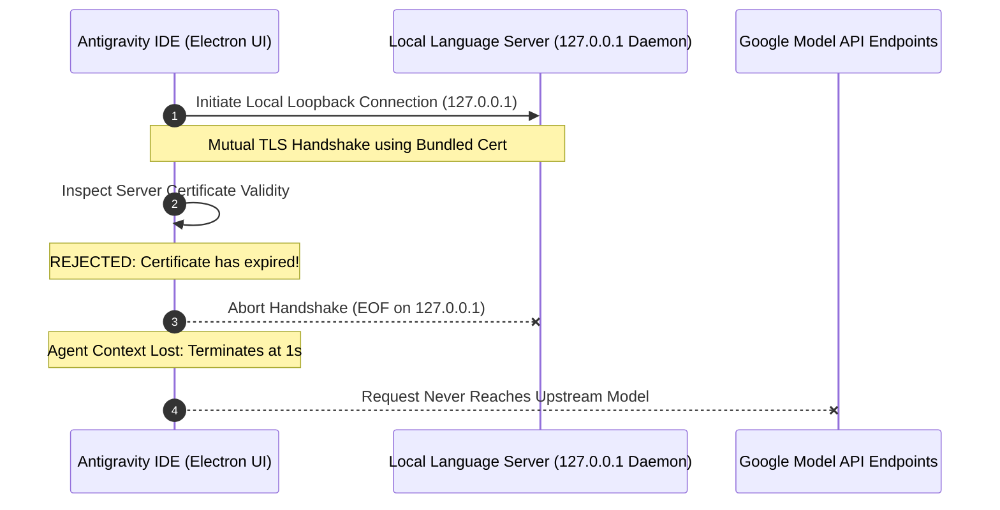

If every prompt submitted to Google Antigravity IDE suddenly fails after approximately one second with a generic termination alert, you are likely encountering an internal TLS certificate expiration bug.

When this occurs, the chat interface displays a brief "Worked for 1s" status indicator before immediately halting:


*Figure 1: The generic catch-all failure in Antigravity IDE after approximately one second of execution.*

```text
Worked for 1s >
Error Agent execution terminated due to error. ▾
Error ID: a7b743e8-e576-48a4-874e-610c719d82af-8
Agent execution terminated due to error.
```

The interface provides no technical context, and the generated `Error ID` UUID is strictly an internal Google telemetry hash. Because this dialog serves as a top-level unhandled exception catch-all, developers frequently spend hours attempting ineffective workarounds like reinstalling extensions, wiping local caches, or disabling Model Context Protocol (MCP) integrations.

This guide details how to extract the real failure signature from the IDE logs, explains why the local language server TLS handshake broke, and outlines the permanent resolution.

> [!NOTE]
> **Quick Diagnostic (TL;DR):**
> 1. Open the **Output** panel (`Ctrl + Shift + U` on Windows/Linux, `Cmd + Shift + U` on macOS).
> 2. Switch the dropdown channel to **Antigravity IDE**.
> 3. If you see `LS check error: [internal] certificate has expired` followed by `TLS handshake error from 127.0.0.1 ... EOF`, your IDE is running an expired bundled certificate.
> 4. **The Fix:** Download and install **Antigravity IDE v2.6.0 or higher** from the official portal. Wiping local state or disabling MCP servers will not resolve this.

---

## How to Find the Real Error in the Output Logs

The frontend UI hides the root cause, but the underlying application logs record the exact failure point.

### Step 1: Open the Output Panel
In Antigravity IDE, navigate to `View` → `Output` or press `Ctrl + Shift + U` (`Cmd + Shift + U` on macOS).

### Step 2: Select the Correct Log Channel
By default, the Output panel may display `Tasks`, `Git`, or extension logs. Click the channel dropdown on the far right of the panel and select **Antigravity IDE**:

```text
[ Output ▾ ] [ Antigravity IDE ▾ ] [ Clear ] [ Lock ]
```

### Step 3: Reproduce the Failure
Submit any prompt to the agent. Within 1–2 seconds, the log will stream recent activity.

### Step 4: Identify the Failure Signature
Filter past ambient startup messages and look specifically for this paired log failure:

```text
[ERROR]: LS check error: [internal] certificate has expired
http: TLS handshake error from 127.0.0.1:52498: EOF
```

If these two lines appear in your log stream, the problem is conclusively identified.

---

## Architectural Breakdown: Why Did the Agent Die After 1 Second?

To understand why this happens, it helps to examine how Google Antigravity operates behind the scenes.

Unlike simple web-based LLM wrappers, Antigravity IDE runs a dual-layer local architecture:



### 1. The Local Language Server Daemon
Antigravity executes an internal background daemon—the **Language Server (LS)**—to index your workspace, parse semantic symbols, monitor file changes, and construct context windows for the agent.

### 2. Encrypted Loopback Communication (127.0.0.1)
To protect communication between the Electron UI process and the local daemon from privilege escalation or local process snooping, the IDE encrypts internal loopback traffic over TLS on `127.0.0.1`.

### 3. The Expired Bundled Certificate
The TLS connection requires a valid SSL/TLS certificate. Rather than relying on your system's certificate store, older Antigravity builds packaged an internal certificate directly into the application distribution.

In early builds (including versions prior to v2.6.0), this bundled localhost certificate had a hardcoded validity period that expired in autumn 2026. 

When your system date crossed that expiration threshold, the IDE's internal TLS client correctly flagged the certificate as expired (`[internal] certificate has expired`) and severed the socket (`EOF`). Because the agent frontend cannot initialize or exchange workspace context without an active Language Server connection, the execution thread terminates after its initial 1-second timeout.

> [!IMPORTANT]
> **System Clock Verification:** This is not a system time drift issue. During our investigation, local system clocks were accurately synchronized via NTP (November 2026). The expiration occurred entirely within the static certificate packaged inside the software binaries.

---

## Log Noise to Ignore: "failed to detect charset"

While reviewing the Antigravity IDE output log, you will frequently see repeated warnings like this:

```text
ERROR: logging before google.Init: E1103 04:18:51.123456 12890 errorreport.go:223] while decoding file, failed to detect charset with sufficient confidence
```

It is easy to mistake this for the root cause because it contains the word `ERROR` and appears immediately before the agent dies.

However, this is harmless background noise. It originates from the IDE's Go-based indexing subsystem attempting to evaluate text encoding across repository files. When the indexer encounters binary assets, SQLite databases, minified vendor bundles, or zero-byte files, it logs an encoding warning and skips the file. 

The `logging before google.Init` prefix simply indicates that the logging library wrote the message prior to full telemetry subsystem initialization. Do not waste time attempting to clean your workspace or convert file encodings—it has zero bearing on the agent termination error.

---

## Troubleshooting Analysis: What Failed vs. What Worked

Before identifying the expired internal certificate, standard recovery methods were tested across affected environments.

| Troubleshooting Attempt | Technical Hypothesis | Result | Why It Failed |
| :--- | :--- | :--- | :--- |
| **Disabling MCP Servers** | Malfunctioning Model Context Protocol tools blocking agent execution. | **Failed** (No change; 1s termination persisted) | MCP servers run as child processes *after* the core agent and language server establish communication. |
| **Resetting Local Cache & `%APPDATA%`** | Corrupted workspace index or stale session state. | **Failed** (No change) | The expired TLS certificate is compiled into static application binaries, not stored in dynamic user cache directories. |
| **Restarting IDE / Workstation** | Zombie language server process holding stale ports. | **Failed** (No change) | On reboot, the IDE relaunches with the same expired certificate binary. |
| **Updating to Antigravity IDE 2.6.0+** | Replace application binaries with updated TLS certificate bundle. | **SUCCESS** (Agent immediately restored) | Version 2.6.0 contains renewed internal certificates and updated loopback transport configurations. |

---

## The Solution: Updating Antigravity IDE to v2.6.0+

The only reliable fix is installing a build with updated internal certificate definitions.

### Step 1: Terminate Existing Antigravity Processes
Ensure no orphaned background worker processes remain locked in memory:

```powershell
# On Windows PowerShell
Get-Process -Name "*antigravity*", "*language-server*" -ErrorAction SilentlyContinue | Stop-Process -Force
```

On macOS or Linux:

```bash
pkill -f -i antigravity
pkill -f -i language-server
```

### Step 2: Download the Latest Stable Installer
Visit the official Google Antigravity download portal:
`https://antigravity.google/download`

Download the installer for your platform (ensure the build version is **v2.6.0** or newer).

### Step 3: Run the Installer Over Your Current Setup
Execute the installer directly over your existing installation directory. This replaces the core Electron package (`app.asar`) and language server binaries while preserving your local configurations, conversation databases, and custom workspace rules.

### Step 4: Verify the Resolution
1. Relaunch Antigravity IDE.
2. Open an existing workspace.
3. Submit a prompt in the agent panel.
4. Verify that execution proceeds through parsing, tool calling, and response streaming without terminating at the 1-second mark.

---

## Alternative Causes (When Updating Does Not Resolve the Error)

If you have upgraded to Antigravity IDE 2.6.0+ and still receive the `Agent execution terminated due to error` dialog, your system is encountering a different fault caught by the same generic handler. Check your Output logs for these patterns:

### 1. Enterprise VPN, Proxy, or Antivirus SSL Inspection
If the log outputs:
```text
x509: certificate signed by unknown authority
```
or
```text
unable to get local issuer certificate
```
An enterprise proxy (such as Zscaler, Netskope, or corporate firewall inspection) is intercepting outbound HTTPS connections to Google's model servers. You must import your organization's root CA certificate into the IDE's certificate store or configure proxy bypass exceptions.

### 2. Upstream API Quota & Rate Limiting (HTTP 429)
If the log streams:
```text
RESOURCE_EXHAUSTED (code 429): Resource has been exhausted
```
Your workspace has exceeded the allowed requests-per-minute (RPM) or token limits on the active model endpoint. Wait 60 seconds before resubmitting or switch the active model tier in your prompt settings.

### 3. Stale Authentication Tokens
If your session token expired:
1. Open the Command Palette (`Ctrl + Shift + P` / `Cmd + Shift + P`).
2. Search for and execute: `Antigravity: Reset Onboarding`.
3. Complete the browser OAuth handshake to regenerate active API credentials.

---

## Security Advisory: Avoid `NODE_TLS_REJECT_UNAUTHORIZED=0`

Some developer discussion threads recommend setting this environment variable to bypass certificate errors:

```bash
# DO NOT USE AS A PERMANENT FIX
export NODE_TLS_REJECT_UNAUTHORIZED=0
```

> [!WARNING]
> **Severe Security Risk:** Setting `NODE_TLS_REJECT_UNAUTHORIZED=0` disables TLS certificate verification across the **entire Electron runtime process**. 
> 
> This does not merely ignore the localhost certificate; it disables validation for:
> - Outbound API calls sending proprietary code to upstream AI endpoints,
> - Extension marketplace downloads,
> - Remote Git repository synchronizations.
> 
> Running with disabled TLS verification exposes your development environment to man-in-the-middle (MITM) attacks and credential harvesting on public or corporate networks. Always apply the official v2.6.0+ application update instead of disabling transport security.

---

## Technical Summary

| Diagnostic Point | Specification |
| :--- | :--- |
| **Reported Symptom** | Every prompt halts after ~1s with `Agent execution terminated due to error` and a random UUID. |
| **Log Location** | View → Output → Select **Antigravity IDE** channel. |
| **Root Error Signature** | `[ERROR]: LS check error: [internal] certificate has expired` |
| **Transport Failure** | `http: TLS handshake error from 127.0.0.1:52498: EOF` |
| **Underlying Mechanism** | Internal loopback TLS certificate bundled inside pre-2.6.0 application binaries expired in late 2026. |
| **Non-Contributing Noise** | `while decoding file, failed to detect charset with sufficient confidence` (Harmless Go indexer log). |
| **Permanent Fix** | Install Antigravity IDE v2.6.0+ from `antigravity.google/download`. |

---

## Frequently Asked Questions

### Why does the agent fail after exactly one second?
Antigravity IDE initiates an asynchronous handshake with the local language server daemon upon receiving a prompt. When the local TLS handshake fails immediately with `EOF`, the agent execution runner encounters a disconnected socket state and terminates once its initial connection timeout expires (~1000ms).

### Does this issue affect both Windows and macOS?
Yes. The bundled localhost TLS certificate was distributed across all operating system packages of the affected release series. While port numbers on `127.0.0.1` vary dynamically per session, the certificate expiration signature is identical across Windows, macOS, and Linux.

### Will reinstalling or updating wipe my previous chats and custom rules?
No. Antigravity IDE separates application binaries from user state. Your chat histories, rules, MCP configuration files, and project settings are stored in `%APPDATA%\Antigravity` (or `~/.config/Antigravity` on UNIX). Installing the update over your existing installation updates only the executable files.

---

## Related Guides

* **[How to Restore Antigravity IDE Workspaces & Missing Chat History](/blog/antigravity-update-issue)**: Fix workspace and profile splitting issues introduced in Antigravity updates.
* **[Stopping the Antigravity IDE Update Loop & Antivirus Freezes](/blog/antigravity-auto-update-antivirus-hang)**: Prevent repetitive background update installer crashes and high disk I/O.
* **[Restoring Missing Gemini Models in Google Antigravity IDE](/blog/gemini-models-disappeared-antigravity-ide)**: Troubleshoot model dropdown synchronization and manifest parsing issues.

