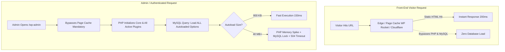
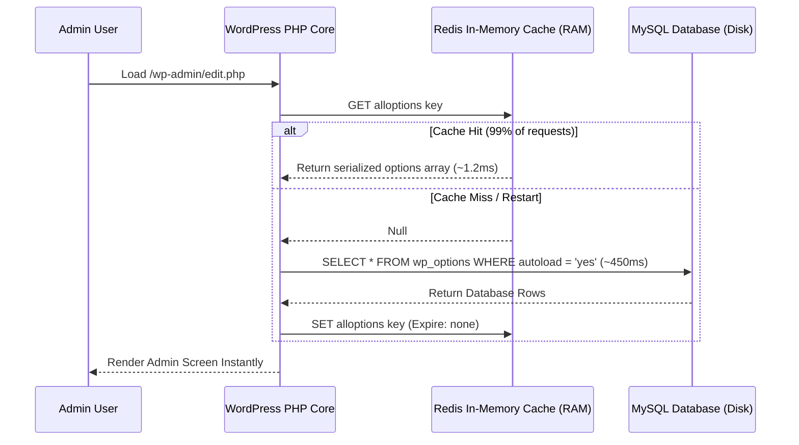

If your WordPress front-end feels reasonably fast to regular visitors, but your backend dashboard (`/wp-admin`) takes 15 to 30 seconds to load, you are experiencing a classic architectural bottleneck.

Saving a draft triggers a browser spinner. Opening the WooCommerce orders tab results in a `504 Gateway Timeout`. Your shared or VPS hosting provider sends warning emails stating that MySQL is consuming 100% of available CPU and RAM.

Many site owners assume the solution is adding another caching plugin or upgrading their hosting tier. But standard page caching cannot cache the WordPress admin. The root cause is almost always **database bloat in the `wp_options` table**, specifically an accumulation of massive, unindexed **autoloaded data**.

In this guide, we examine the underlying architecture of WordPress autoloading, how to measure your exact database footprint using SQL, how to safely prune orphaned records, and how to permanently eliminate admin lag without corrupting your database.

> [!NOTE]
> **Executive Summary (TL;DR):**
> * **The Symptom:** Fast front-end (masked by static page cache) but sluggish, timing-out `/wp-admin` dashboard.
> * **The Cause:** Every single WordPress request executes:  
>   `SELECT option_name, option_value FROM wp_options WHERE autoload = 'yes'`  
> * **The Benchmark:** A healthy database has **under 800 KB** of autoloaded data. Many neglected sites carry **30 MB to 100 MB+** of ghost transients and dead plugin logs.
> * **The Danger:** Never run bulk `DELETE` queries on active options. Safely purge transients, flip `autoload` from `yes` to `no` on non-critical rows, and deploy a persistent Redis object cache.

---

## Why Is the WordPress Admin Slow While the Front-End Is Fast?

To understand why your admin dashboard freezes while your homepage loads instantly, look at how WordPress handles cached vs. uncached requests:



Front-end visitors rarely execute database queries because caching layers (WP Rocket, LiteSpeed, Nginx FastCGI, or Cloudflare APO) intercept incoming HTTP requests and serve pre-rendered static HTML files directly from disk or memory.

However, **the WordPress admin cannot be cached**. Every time an administrator loads a page, edits a post, views an order, or triggers an AJAX call:
1. WordPress boots the entire PHP core runtime.
2. It initializes every active plugin and theme.
3. It connects to MySQL and executes its very first query: loading every row in `wp_options` marked with `autoload = 'yes'`.

If your autoloaded data is small, this query executes in milliseconds. But if your database has accumulated years of plugin baggage, PHP is forced to allocate tens of megabytes of memory on every click just to parse giant serialized arrays.

---

## What Is Autoloaded Data in `wp_options`?

The `wp_options` table is the heart of any WordPress installation. It stores site-wide configuration settings: your site URL, active theme configurations, plugin options, widget data, and transient caches.

The table schema includes four core columns:
* `option_id` (Primary key)
* `option_name` (The unique key identifying the setting)
* `option_value` (The stored data, often serialized PHP arrays or JSON strings)
* `autoload` (A flag set to `'yes'` or `'no'`—or `'on'`/`'off'` in modern WordPress releases)

### The `alloptions` Mechanism
To prevent plugins from making dozens of individual database queries for every minor setting, WordPress groups all rows where `autoload = 'yes'` into a single cached array called `alloptions`.

On startup, WordPress runs:

```sql
SELECT option_name, option_value 
FROM wp_options 
WHERE autoload = 'yes';
```

When functioning as intended, this is an efficient design. A clean, modern WordPress site loads approximately **300 to 800 KB** of configuration data into memory once, and plugins access their settings instantly without further database queries.

### How Autoloading Breaks Down in Production
The breakdown happens when developers treat `wp_options` as a temporary storage dump or logging bucket. Common culprits include:
1. **Abandoned Plugins:** Deleting a plugin via the WordPress dashboard rarely deletes its database rows. Many plugins deliberately leave their settings intact in case you reinstall them later.
2. **Expired Transients:** Temporary cache entries (API tokens, currency exchange rates, external feed caches) are set to autoload, but WordPress cron fails to garbage-collect them after expiration.
3. **Internal Event Logs:** Redirection plugins, broken security scanners, and form plugins mistakenly write user tracking data, error logs, or submitted lead payloads into single autoloaded options.
4. **Massive Serialized Arrays:** Page builders and sliders that store complete layout trees in serialized options reaching 5 MB to 15 MB in a single database row.

When the `alloptions` payload swells to 30 MB or 70 MB, PHP must allocate that memory **per concurrent user request**. If two administrators and five authenticated users browse the site simultaneously, the server exhausts its PHP `memory_limit`, the database locks, and the entire backend crashes.

---

## Step-by-Step: Diagnosing Autoload Bloat

Before changing any settings, you must measure your database footprint and identify the specific rows causing the bottleneck.

> [!IMPORTANT]
> **Safety First:** Always generate an uncompressed database backup before executing diagnostic or modification queries.
> ```bash
> wp db export pre_cleanup_backup_$(date +%F).sql
> ```

### Step 1: Measure Total Autoloaded Size
Log in to phpMyAdmin, Adminer, or your MySQL CLI, and execute the following query:

```sql
SELECT 
    ROUND(SUM(LENGTH(option_value)) / 1024 / 1024, 2) AS autoload_size_mb,
    COUNT(*) AS total_autoloaded_rows
FROM wp_options 
WHERE autoload IN ('yes', 'on');
```

#### How to Interpret Your Result:
* **Under 800 KB (&lt; 0.8 MB):** Optimal. Your database is lean and healthy.
* **1 MB to 2.5 MB:** Acceptable for complex WooCommerce or LearnDash setups.
* **3 MB to 10 MB:** Noticeable admin dashboard sluggishness. Optimization recommended.
* **10 MB to 100 MB+:** Critical bottleneck. Severe memory pressure, frequent timeouts, and hosting resource limit violations.

### Step 2: Identify the Top 10 Heaviest Autoloaded Rows
Once you know your total size, run this query to expose which specific keys are consuming the bulk of that memory:

```sql
SELECT 
    option_id,
    option_name, 
    ROUND(LENGTH(option_value) / 1024, 2) AS size_kb
FROM wp_options 
WHERE autoload IN ('yes', 'on') 
ORDER BY LENGTH(option_value) DESC 
LIMIT 10;
```

In almost every troubled site, **80% of the total autoload bloat comes from fewer than 15 individual rows**.

Typical output looks like this:

| option_id | option_name | size_kb | Root Source |
| :--- | :--- | :--- | :--- |
| 14820 | `_transient_wc_var_prices_14920` | 4,812.40 | Stale WooCommerce variation cache |
| 8912 | `displayed_galleries` | 3,120.15 | Legacy gallery plugin uninstalled 2 years ago |
| 23411 | `jetpack_waf_ip_rules` | 2,450.80 | Expired firewall IP blacklist |
| 1042 | `redirection_404_logs` | 1,890.22 | 404 URL tracking storing thousands of URLs |
| 19402 | `cron` | 1,240.00 | Corrupted cron queue with 8,000 stalled events |

---

## The Production Cleanup Procedure

Once you have identified the offending rows, proceed with a surgical, non-destructive cleanup.

### Phase 1: Clean Expired Transients Safely
Transients are temporary cache entries stored in `wp_options`. When a transient expires, WordPress is supposed to delete it the next time it is queried. However, if a plugin is uninstalled or a transient is never queried again, it sits in `wp_options` forever.

On sites running for multiple years without maintenance, it is common to find 50,000+ orphaned transients.

#### The Safe Method: Use WP-CLI
If you have SSH access, use the native WP-CLI command. This method ensures that object caches are flushed and core hooks run cleanly:

```bash
# Delete all expired transients
wp transient delete --expired

# If your database is severely bloated, delete all transients (they will regenerate cleanly on demand)
wp transient delete --all
```

#### The SQL Method (phpMyAdmin)
If you do not have command-line access, execute this two-step query in phpMyAdmin to remove transients that have definitively passed their expiration timestamp:

```sql
-- Step 1: Delete expired transient data
DELETE a, b 
FROM wp_options a 
LEFT JOIN wp_options b 
    ON b.option_name = CONCAT('_transient_timeout_', SUBSTRING(a.option_name, 12)) 
WHERE a.option_name LIKE '_transient_%' 
  AND a.option_name NOT LIKE '_transient_timeout_%' 
  AND b.option_value < UNIX_TIMESTAMP();

-- Step 2: Delete expired transient timeouts
DELETE FROM wp_options 
WHERE option_name LIKE '_transient_timeout_%' 
  AND option_value < UNIX_TIMESTAMP();
```

### Phase 2: Flip Autoload to 'no' for Large Active Options
When you discover massive configuration rows that belong to active plugins (such as SEO sitemap caches, WooCommerce tax tables, or page builder CSS definitions), **do not delete them**. Deleting them will cause PHP fatal errors or wipe your settings.

Instead, change their `autoload` status from `'yes'` to `'no'`:

```sql
UPDATE wp_options 
SET autoload = 'no' 
WHERE option_name = 'name_of_large_option_row';
```

#### Why Does This Work?
When `autoload = 'no'`, WordPress excludes that row from the initial startup query. If the plugin actually needs that data later during an explicit operation (e.g., when generating a sitemap or rendering a specific shortcode), it queries MySQL directly for that single key using `get_option('name_of_large_option_row')`.

By flipping 5 to 10 massive rows from `'yes'` to `'no'`, you instantly remove 20 MB+ from every single admin request without breaking a single plugin feature.

### Phase 3: Purge Dead Plugin Artifacts
Examine your top memory-consuming rows against your currently active plugins:
1. Open your WordPress dashboard and navigate to **Plugins** → **Installed Plugins**.
2. Note any plugin that was uninstalled months or years ago.
3. If you find leftover options in `wp_options` prefixed with that dead plugin's namespace (e.g., `revslider_`, `yoast_seo_links_`, `wpcf7_` on a site that migrated to Gravity Forms), delete those specific rows:

```sql
-- Replace 'dead_plugin_prefix_' with the exact option_name identified in Step 2
DELETE FROM wp_options 
WHERE option_name = 'dead_plugin_prefix_specific_key';
```

> [!WARNING]
> **Avoid Wildcard Deletions:** Never run blanket wildcard queries like `DELETE FROM wp_options WHERE option_name LIKE '%slider%'`. Many modern plugins share generic substrings. Always target specific, verified option names.

---

## Architectural Comparison: Cleanup Approaches

| Approach | Risk Level | Long-Term Impact | Operational Effort |
| :--- | :--- | :--- | :--- |
| **"Database Optimizer" Plugins** | **High** | Temporary | Low (Run automated sweep) |
| **Blind SQL `DELETE` Queries** | **Critical (High Risk of Data Loss)** | Unpredictable (Can crash theme/plugins) | Low (Single query in phpMyAdmin) |
| **Surgical Autoload Pruning (`autoload = 'no'`)** | **Extremely Low** | Permanent 80%+ reduction in admin RAM | Moderate (Identify top rows, verify source) |
| **Persistent Object Caching (Redis/Memcached)** | **Zero** | Eliminates disk I/O, sub-millisecond lookups | Moderate (Server daemon + PHP extension) |

---

## The Long-Term Solution: Persistent In-Memory Object Caching

Cleaning bloated rows fixes historical accumulation. But to prevent future queries from bogging down your admin dashboard, you should decouple `wp_options` lookups from MySQL disk I/O entirely.

By default, WordPress's internal object cache is non-persistent: it lives only for the duration of a single HTTP request and is destroyed immediately after the page finishes rendering.

### Deploying Redis or Memcached
When you configure a persistent object caching daemon like Redis:
1. On the very first request, WordPress reads the `alloptions` payload from MySQL and writes it into Redis RAM.
2. For all subsequent requests across the entire site, WordPress reads `alloptions` directly from Redis in **under 2 milliseconds**.
3. When an option is updated in `/wp-admin`, the Redis cache key is invalidated and updated asynchronously.



By pairing a clean `wp_options` table (under 1 MB) with an in-memory Redis drop-in, your WordPress admin dashboard will maintain sub-second response times regardless of catalog size or editorial activity.

---

## When to Seek Senior Engineering Help

While purging transients is straightforward, database surgery on high-traffic sites carries genuine risks:
* **WooCommerce Session Desynchronization:** Truncating or modifying session tables incorrectly can log active customers out of their shopping carts during live checkout.
* **Corrupted Serialized Data:** Using non-serialized search-and-replace tools on PHP serialized strings will corrupt character counts, rendering options unreadable by WordPress.
* **Complex Multi-Site Networks:** In WordPress multisite (`wp_sitemeta`), options are shared across multiple domains, requiring network-level cache invalidation.

If your database exceeds 5 GB, your site handles continuous live transactions, or your web host has threatened account suspension due to resource abuse, a structured [performance audit](/free-audit) or dedicated [database optimization sprint](/freelance-wordpress-developer) ensures your backend is cleaned safely without a second of downtime.

---

## Frequently Asked Questions

### Will cleaning autoloaded data break my live site?
Not if you follow the three-phase methodology. Deleting expired transients and dead plugin records is safe because the underlying plugins are no longer present. For active plugins, changing `autoload` from `yes` to `no` does not delete the setting—it simply tells WordPress to query it on demand rather than loading it on every request.

### Why do "Database Cleaner" plugins fail to solve slow admin dashboards?
Most automated database optimization plugins (like WP-Optimize or Advanced Database Cleaner) focus primarily on deleting post revisions, spam comments, and auto-drafts. While this reduces total disk space, post revisions have **zero impact on the autoloaded memory footprint**. If an automated tool does not inspect the specific byte length of individual `wp_options` rows, your admin dashboard will remain slow.

### How often should I check autoloaded data?
For a stable content website, an annual audit is sufficient. For active WooCommerce stores, membership communities, or sites that frequently test third-party plugins, inspect your top autoloaded options **quarterly** or after any major platform migration.

---

## Related Guides

* **[How to Speed Up a Slow WordPress Website: The Complete Performance Guide](/blog/how-to-speed-up-slow-wordpress-website)**: Comprehensive audit strategies for Core Web Vitals, server response times, and asset delivery.
* **[Troubleshooting WordPress Site Crashes After Plugin Updates](/blog/wordpress-site-crashed-after-plugin-update)**: Step-by-step recovery procedures when fatal errors break your site layout.
* **[Fixing Resource Abuse Suspensions on Shared Hosting](/blog/wordpress-suspended-namecheap-resource-usage-jetpack)**: How unoptimized background crons and database spikes trigger web host suspensions.

