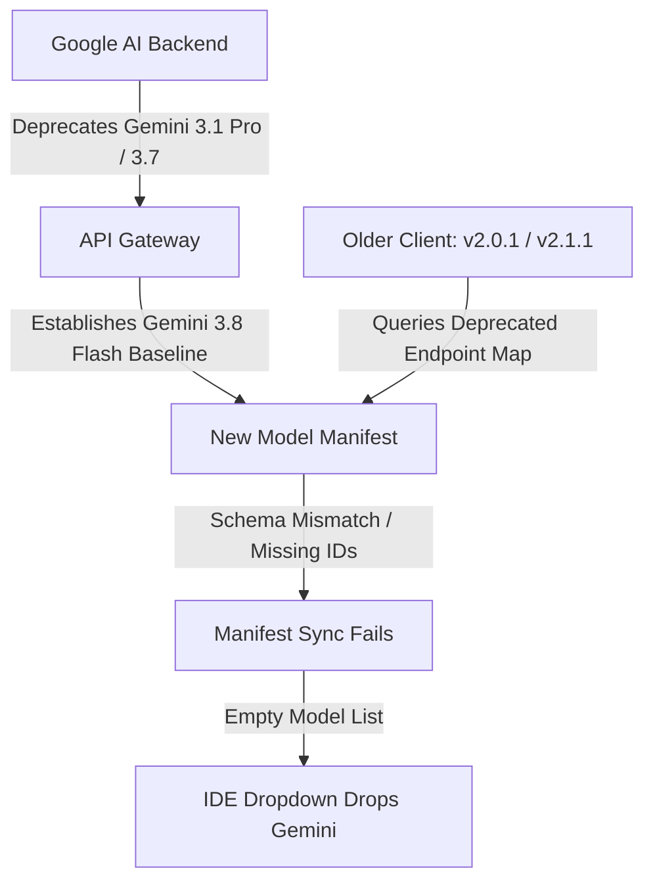

If you opened Google Antigravity IDE recently and noticed that every native Gemini model suddenly vanished from your model selector dropdown, you are experiencing a widespread backend synchronization issue.

Instead of the standard Gemini models, developers across multiple regions reported seeing either an empty selector, unexpected routing errors when sending prompts, or a list restricted entirely to third-party model endpoints (such as Claude or GPT).

```text
Antigravity IDE Model Dropdown:
[ Select Model ▾ ]
  ├── Anthropic Claude 3.5 Sonnet
  ├── OpenAI GPT-4o
  └── (No Gemini models available)  <-- Missing
```

This is not a local corruption of your project workspace or a revoked subscription. It is the result of backend API endpoint retirements coinciding with client-side manifest desynchronization in older IDE builds.

This article outlines the root technical breakdown, explains why older client versions broke silently, and provides the step-by-step procedure to restore your workspace.

> [!NOTE]
> **Quick Answer (TL;DR):** If your Gemini models vanished from the Antigravity IDE dropdown:
> 1. **Upgrade Client:** Update Antigravity IDE to **v2.5.5** or higher from the [official Antigravity download page](https://antigravity.google/download#antigravity-ide).
> 2. **Clear Onboarding Cache:** Open the Command Palette (`Ctrl + Shift + P` or `Cmd + Shift + P`) and execute `Antigravity: Reset Onboarding`.
> 3. **Re-authenticate:** Complete the browser OAuth login to fetch the updated model routing table.

---

## Observed Symptoms

The failure presents in several ways depending on your IDE version, operating system, and subscription tier:

* **Empty Model Selector:** The dropdown list displays third-party provider models or nothing at all, with no Gemini entries visible.
* **Fallback to Third-Party Endpoints:** Background agent tasks default to Claude or GPT endpoints, incurring unexpected third-party token usage or failing when those keys are not configured.
* **Routing Exception on Prompt Execution:** Attempting to submit prompts triggers an error dialog indicating that the target model ID cannot be resolved by the local provider interface.
* **Authentication Loop:** Signing out and signing back in through the account panel fails to refresh the available model list.

---

## Root Cause Breakdown

The disappearance of Gemini models is not a single bug, but the convergence of three distinct platform shifts:



### 1. Backend Endpoint Retirements (Gemini 3.1 Pro & 3.7)

Google formally began retiring legacy Gemini endpoints across developer and enterprise tiers. In particular, older preview builds of Gemini 3.1 Pro and intermediate 3.7 checkpoints reached end-of-life. When backend services decommission an endpoint, any client querying that specific identifier receives an deprecation status or null entry in the capability catalog.

### 2. Baseline Shift to Gemini 3.8 Flash

Google shifted the default system baseline for Antigravity IDE, Google AI Pro, and enterprise partner tiers to **Gemini 3.8 Flash**. This change aims to deliver significantly faster completion latency and improved operational efficiency for iterative coding workflows. However, the model definition schema accompanying 3.8 Flash introduces structural properties that older client parsers do not recognize.

### 3. Client Manifest Desynchronization (v2.0.1 / v2.1.1)

Older client versions (notably v2.0.1 released in mid-2026 and subsequent v2.1.1 builds) maintain a hardcoded fallback manifest and an endpoint query contract designed around the 3.1 Pro specification.

When the backend retired those endpoints and published the updated model catalog:
1. Older clients queried the catalog endpoint.
2. The legacy parser encountered unmapped model descriptors and failed validation checks silently.
3. The client discarded the invalid nodes rather than displaying an error.
4. Consequently, the UI rendered an empty Gemini list or fell back to secondary vendor APIs registered locally.

### 4. Regional and Subscription Sync Latency

Developers utilizing bundled partner tiers (such as Google AI Pro workspace plans) experienced extended manifest delays. In some availability zones, cached CDN manifests served stale routing tables for several hours after backend deprecations took effect, exacerbating the problem.

---

## Step-by-Step Resolution Guide

Restoring the Gemini model family requires refreshing both the local application binary and the cached authentication tokens.

### Step 1: Upgrade Antigravity IDE to v2.5.5 or Higher (Mandatory)

Running a legacy IDE client will continue to fail manifest validation regardless of how many times you restart or log in. 

1. Close all active Antigravity IDE windows.
2. Download the latest installer from the official Google portal:
   * **Direct Link:** [Antigravity IDE Download](https://antigravity.google/download#antigravity-ide)
3. Run the installer to update your application binary to version **v2.5.5** or above.

> [!TIP]
> If your IDE previously suffered from failed background updates or installer loops on Windows, refer to our guide on [Resolving Antigravity IDE Auto-Update Loops and Antivirus Hangs](/blog/antigravity-auto-update-antivirus-hang) before running the installer.

### Step 2: Clear Onboarding Cache and Reset State

Even after updating the client binary, the IDE may continue reading invalid model lists from local session storage. You must explicitly reset onboarding state to force a clean sync.

1. Launch **Antigravity IDE**.
2. Open the Command Palette:
   * **Windows / Linux:** `Ctrl + Shift + P`
   * **macOS:** `Cmd + Shift + P`
3. Type the following command and press **Enter**:
   ```text
   Antigravity: Reset Onboarding
   ```
4. Confirm the prompt if prompted to restart or reload the window.

### Step 3: Complete Browser OAuth Re-Authentication

Once the onboarding state resets:

1. Click the **Sign In** prompt in the bottom status bar or inside the chat interface.
2. The IDE will redirect you to your browser for Google account OAuth verification.
3. Select your Google account and grant the required permissions.
4. Return to the IDE. Upon authorization, the newly installed v2.5.5 client fetches the fresh manifest, registering Gemini 3.8 Flash into your environment.

### Step 4: Verify Model Availability

Open any chat session or autonomous agent panel. Expand the model selector dropdown. You should now see:

* **Gemini 3.8 Flash (Default Baseline)**
* Advanced Google reasoning checkpoints (depending on your subscription tier)
* Configured third-party fallback providers

---

## Operational Adjustments: Working with Gemini 3.8 Flash

Transitioning from Gemini 3.1 Pro to Gemini 3.8 Flash involves more than an endpoint swap. The underlying reasoning profile and operational characteristics differ noticeably.

### Tradeoff Analysis: 3.1 Pro vs. 3.8 Flash

| Dimension | Legacy Gemini 3.1 Pro | Gemini 3.8 Flash (Baseline) | Operational Impact |
| :--- | :--- | :--- | :--- |
| **Response Latency** | Moderate (~2.5s - 5.0s TTFT) | Extremely Low (< 900ms TTFT) | Faster iterative loops, instantaneous terminal command proposals |
| **Token Cost / Quota Usage** | High consumption rate | Low consumption rate | Extends usable quota for large codebases and complex file diffs |
| **Implicit Reasoning** | Strong on vague instructions | Requires explicit structure | Prompts must be concrete to avoid superficial code refactoring |
| **Multi-File Context Retention** | Deep historical synthesis | Strict context prioritization | Large transcripts require modular prompts rather than monolithic history |

### Prompting Strategy for Gemini 3.8 Flash

Because Gemini 3.8 Flash is optimized for speed and cost efficiency, it performs best when provided with direct constraints rather than open-ended objectives.

#### 1. Provide Explicit Structural Contracts
Avoid asking for open-ended refactoring. Provide exact inputs, expected outputs, and constraints.

* **Suboptimal Prompt:**
  ```text
  Fix the database connection error in this Express route.
  ```
* **Engineered Prompt:**
  ```text
  Analyze the following PostgreSQL connection pool in our Express service. 
  Identify why idle clients time out after 30 seconds.
  Return only the updated connection pool configuration with keepalive flags enabled.
  ```

#### 2. Request Multi-Step Reasoning Before Code Generation
When dealing with multi-file architectures or subtle race conditions, instruct the model to state its diagnostic observations prior to proposing file changes. This forces the model to engage deeper chain-of-thought pathways.

```text
Before proposing code modifications:
1. State the observed failure mechanism.
2. Identify which file holds the authoritative state.
3. List any operational tradeoffs introduced by your proposed fix.
```

---

## When Not to Rely Solely on IDE-Managed Endpoints

While the integrated model selector provides seamless out-of-the-box convenience, relying entirely on IDE-managed manifest routing can create a single point of failure in critical production environments.

### Consider Self-Managed API Keys When:
* **Operating in Enterprise Air-Gapped Environments:** Organizations with strict egress firewalls should route requests through internal API gateways using explicit API keys rather than client-managed OAuth tokens.
* **Running Automated CI/CD Pipelines:** Background batch jobs and test runners should never depend on IDE client manifests. Use standard Google Cloud Vertex AI or Google AI Studio SDKs.
* **Requiring Long-Context Analytical Audits:** For comprehensive whole-repository refactoring where heavy analytical reasoning is non-negotiable, configuring dedicated reasoning models via custom provider endpoints ensures predictable output.

---

## Conclusion & Preventive Best Practices

Toolchain disruptions are an inevitable reality of modern agentic development. As cloud AI providers accelerate the release and deprecation lifecycle of foundational models, client IDEs must continuously adapt their local manifest contracts.

To minimize future workflow interruptions:
1. **Pin Critical Tooling Releases:** Check the Antigravity release notes periodically and avoid lagging more than two minor versions behind the latest stable build.
2. **Understand Workspace Boundaries:** If your workspace layout or chat history encounters issues after major updates, review our technical walkthrough on [How to Fix Antigravity 2.0 IDE Workspace and File Explorer Issues](/blog/antigravity-update-issue).
3. **Decouple Tooling from Data Pipelines:** Maintain direct API script fallbacks for critical analytics or SEO tasks, as outlined in our guide to [Connecting Your IDE Directly to Google Analytics and Search Console APIs](/blog/agentic-ide-analytics-integration).

By upgrading to **v2.5.5** and resetting your local onboarding state, your environment will remain aligned with Google's updated model infrastructure while preserving full development velocity.
