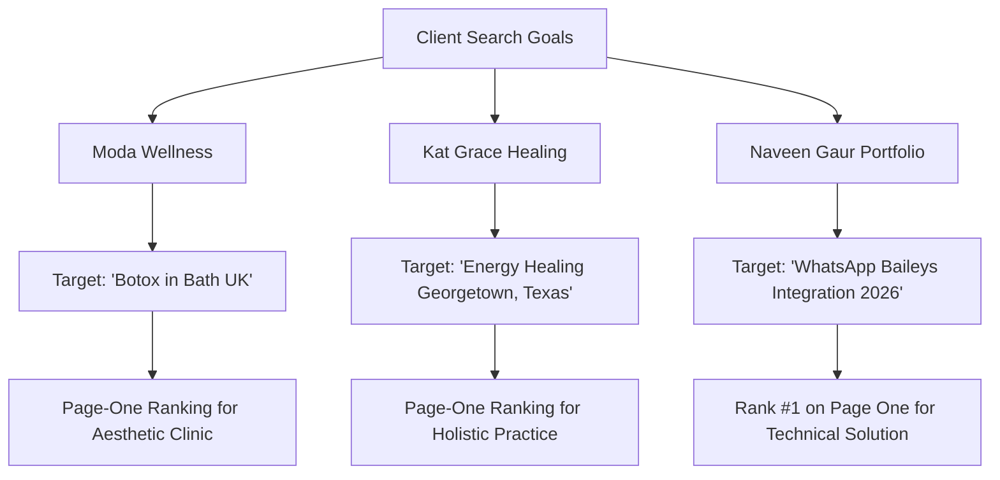

Building a beautiful WordPress website is only the first step. Having a modern design means very little if your ideal clients cannot find you when actively searching Google for the exact services you provide.

Every day, business owners, clinic directors, coaches, and founders ask the same question:  
**“Why is my WordPress website not ranking on Google’s first page?”**

If your site is sitting on page two, page three, or nowhere to be found, your high-value inquiries and potential sales are quietly going to your competitors.

```text
The Search Visibility Equation:
[ High Search Demand ] + [ Clear Search Intent ] + [ Clean Technical Execution ]
                         │
                         ▼
        [ First-Page Discovery & Qualified Inquiries ]
```

As a full-stack WordPress developer and technical SEO consultant, I combine clean code architecture, Core Web Vitals optimization, and search-focused content to help businesses earn lasting organic rankings on Google.

Below, you can review **three real-world ranking achievements** across medical aesthetics, holistic practice, and custom software—followed by how my methodology translates into a repeatable client engagement.

> [!NOTE]
> **A Grounded Reality Check on Rankings:**
> In SEO, there are no secret shortcuts or permanent guarantees. Search results fluctuate across locations, devices, and algorithmic updates. The rankings below represent verified, observable results achieved by solving real technical and content problems on WordPress—not marketing hype.

---

## 1. Three Real-World Ranking Proof Points

Rather than relying on abstract theories, here are three real-world examples demonstrating how search intent alignment and technical rigor produce organic search visibility on Google.



### Result A: ModaWellness (Aesthetic Medicine in the UK)
* **Target Search Query:** `"Botox in Bath UK"`
* **Demonstrated Search Result:** **Page-One Ranking on Google**
* **The Strategic Problem:** Dr. Naim Toci's aesthetic clinic in Bath had clinical expertise, but a mobile PageSpeed score of **42/100** and missing structured data prevented search crawlers from recognizing the clinic's authority.
* **The Technical Solution:** Remedied Core Web Vitals on WordPress (boosting mobile PageSpeed to **91/100**), eliminated render-blocking scripts, and injected custom `MedicalBusiness`, `Physician`, and `MedicalProcedure` JSON-LD schema.
* **Inspect the Work:** [Live Client Site: modawellness.co.uk](https://modawellness.co.uk/) · [Read the Full WordPress Clinic Case Study →](/blog/local-seo-case-study-botox-in-bath-uk)

### Result B: Kat Grace Healing (Holistic Practice in Texas)
* **Target Search Query:** `"Energy Healing Georgetown, Texas"`
* **Demonstrated Search Result:** **Page-One Ranking on Google**
* **The Strategic Problem:** Balancing global virtual sessions with local in-person clients. A typical agency approach would have created multiple thin, cannibalizing city doorway pages.
* **The Technical Solution:** Preserved and strengthened the existing authoritative URL (`/energy-healing/`) on WordPress/Elementor, refined geographic metadata for Georgetown & Austin, structured transparent session tiers, and deployed `FAQPage` schema.
* **Inspect the Work:** [Live Service Page: katgrace.com/energy-healing/](https://katgrace.com/energy-healing/) · [Read the Full Coaching SEO Case Study →](/blog/local-seo-case-study-energy-healing-georgetown-texas)

### Result C: My Portfolio Website (Technical Automation Engineering)
* **Target Search Query:** `"WhatsApp Baileys Integration 2026"`
* **Demonstrated Search Result:** **Rank #1 on Page One on Google**
* **The Strategic Problem:** Developers and technical CTOs search for dependable solutions to complex WebSocket connection drops and session handling.
* **The Technical Solution:** Authored a deep, production-hardened technical guide covering multi-file auth state, status code 515 restart handling, memory leak prevention, and Linux VPS PM2 deployment.
* **Inspect the Work:** [Read the WhatsApp Baileys Integration Guide →](/blog/whatsapp-baileys-integration-guide)

---

## Looking to Get Your WordPress Website on Google's First Page?

If your website is struggling to attract visitors or convert them into inquiries, let's look at the actual data.

* **Get an Honest Diagnostic:** Request a [Free Technical Website & SEO Audit](/free-audit) to uncover what is holding your site back.
* **Direct Consultation:** [Contact me directly](/contact) to discuss your business, target search queries, and website growth goals.

---

## 2. What These Results Actually Demonstrate

Examining these three disparate use cases—an aesthetic clinic, a spiritual healing practice, and an advanced developer engineering guide—reveals the common denominators of modern search visibility:

1. **Precision Search Intent Alignment:** None of these pages targeted broad vanity keywords like "Aesthetics", "Healing", or "Coding". They targeted specific, commercial phrases typed by searchers ready to take action.
2. **Technical Health as a Pre-requisite:** A site burdened by slow load times, uncompressed assets, and layout shifts will struggle to rank, especially on mobile. Clean code and fast Core Web Vitals provide the foundation.
3. **Structured Entity Schema (Machine Readability):** Search engines and AI answer engines (ChatGPT, Perplexity) do not want to guess your physical location or clinical credentials. Structured JSON-LD schema translates your business into machine-readable facts.
4. **Internal Linking Clusters:** High-performing websites do not treat blog articles as isolated islands. Supporting case studies, technical guides, and core service pages must link together logically.

---

## 3. How We Work Together: The 4-Stage Client Engagement Sequence

When clients hire me to improve their website's organic visibility, we work through a structured, predictable sequence designed to generate real business inquiries:

```text
The Client Engagement Sequence:
┌─────────────────────────────────────────────────────────────────┐
│ 1. Comprehensive Baseline Audit (Technical Health & SERP Gaps)  │
│ 2. Opportunity Roadmap & Commercial Keyword Architecture        │
│ 3. Technical, On-Page & Schema Implementation                   │
│ 4. Search Verification, Performance Tuning & Retainer Growth    │
└─────────────────────────────────────────────────────────────────┘
```

### Stage 1: Comprehensive Baseline Audit & Diagnostics
Before changing any code, we identify the exact bottlenecks holding your WordPress site back:
* **Crawlability & Indexing:** Checking Google Search Console for crawl errors, blocked resources in `robots.txt`, or orphaned pages.
* **Core Web Vitals:** Measuring Largest Contentful Paint (LCP), Cumulative Layout Shift (CLS), and Interaction to Next Paint (INP) across mobile devices.
* **Entity Gaps:** Auditing missing or malformed JSON-LD schema that prevents AI search engines from recognizing your business.

### Stage 2: Opportunity Roadmap & Commercial Keyword Architecture
We identify the highest-converting queries for your specific market:
* Pinpointing commercial queries with genuine purchasing or booking intent rather than vanity terms.
* Mapping target queries to specific URLs, deciding whether to optimize existing pages or build new targeted service containers.
* Designing clear service tiers and transparent pricing structures to reduce visitor hesitation.

### Stage 3: Technical, On-Page & Schema Implementation
I implement the changes directly in your codebase or CMS (WordPress, Next.js, Elementor):
* Resolving server bottlenecks, asset compression, and script execution delays.
* Optimizing `<title>` tags, meta descriptions, and semantic heading hierarchies (`H1` → `H2` → `H3`).
* Injecting custom JSON-LD schema (`LocalBusiness`, `Physician`, `Service`, `FAQPage`) directly into templates without plugin bloat.

### Stage 4: Indexing Verification, Performance Tuning & Growth
Once updates are live:
* We request re-indexing through Google Search Console and monitor initial impression shifts.
* We establish internal linking clusters connecting high-traffic blog guides to your main booking pages.
* Ongoing monitoring via our [WordPress Maintenance Retainers](/wordpress-maintenance) ensures that plugin updates or server shifts never degrade your speed or search rankings.

---

## Ready to Turn Your WordPress Website into a Client Acquisition Engine?

Whether you need to capture local customers in your city or establish technical authority across a competitive national niche, organic rankings require disciplined technical execution.

* **Step 1:** Request your [Free Technical Website & SEO Audit](/free-audit).
* **Step 2:** Hire a dedicated specialist: Explore our [Freelance WordPress Developer Services](/freelance-wordpress-developer) for custom builds and Core Web Vitals optimization.
* **Step 3:** Explore our [WordPress Maintenance & Retainer Plans](/wordpress-maintenance) for ongoing speed and security.
* **Step 4:** [Reach out directly](/contact) to schedule a consultation and review your site's search potential.
