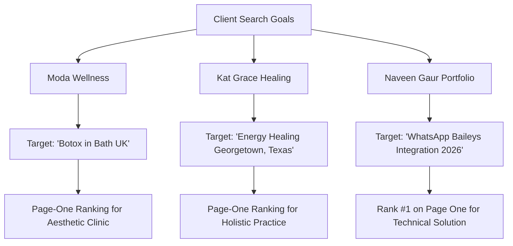

Building a modern website is only the first step. Having a beautifully designed site means very little if potential customers cannot find you when actively searching for your services.

Every day, prospective clients in your industry type specific questions, service requests, and geographic queries into search bars. If your business appears on page two, page three, or nowhere at all, those high-value inquiries quietly go to your competitors.

```text
The Search Visibility Equation:
[ High Search Demand ] + [ Clear Search Intent ] + [ Clean Technical Execution ]
                         │
                         ▼
        [ First-Page Discovery & Qualified Inquiries ]
```

As a full-stack developer and technical SEO consultant, I combine clean website development, Core Web Vitals optimization, and search-focused content architecture to help businesses earn lasting organic visibility.

Below, I share **three real-world ranking achievements** from my portfolio and client projects, followed by the exact, practical framework I use to achieve them.

> [!NOTE]
> **A Grounded Reality Check on Rankings:**
> In SEO, there are no secret tricks or permanent guarantees. Search results fluctuate across locations, devices, and algorithmic updates. The rankings below represent verified, observable results achieved by solving real technical and content problems—not snake-oil promises.

---

## 1. Three Real-World Ranking Achievements

Rather than relying on abstract theories, here are three real-world examples demonstrating how search intent alignment and technical rigor produce organic search visibility.



---

### Example A: ModaWellness (Aesthetic Clinic in the UK)

* **Target Search Query:** `"Botox in Bath UK"`
* **Reported Search Outcome:** **Page-One Ranking on Google**
* **The Strategic Context:** Aesthetic medical treatments are intensely local and require exceptional trust. Prospective patients searching for Botox in Bath want a qualified local doctor, not a generic national directory.
* **The Implementation:** We performed an exhaustive technical SEO audit, resolved severe mobile performance bottlenecks (improving mobile PageSpeed from 42 to 91), and implemented medical JSON-LD schema (`MedicalBusiness`, `Physician`, `MedicalProcedure`) to establish clinical E-E-A-T credentials.
* **Explore the Full Breakdown:** [Read the ModaWellness Local SEO Case Study](/blog/local-seo-case-study-botox-in-bath-uk)

---

### Example B: Kat Grace Healing (Holistic Practice in Texas)

* **Target Search Query:** `"Energy Healing Georgetown, Texas"`
* **Reported Search Outcome:** **Page-One Ranking on Google**
* **The Strategic Context:** Independent practitioners frequently struggle to balance local in-person bookings with virtual/distance offerings. Many make the mistake of creating dozens of thin, duplicate city pages that dilute their domain authority.
* **The Implementation:** Instead of creating fragmented doorway pages, we preserved the established authority of her core service URL (`/energy-healing/`). We refactored title tags and metadata to explicitly target Georgetown and Austin, structured transparent session tiers, and deployed comprehensive `FAQPage` and `LocalBusiness` schema.
* **Explore the Full Breakdown:** [Read the Kat Grace Local SEO Case Study](/blog/local-seo-case-study-energy-healing-georgetown-texas)

---

### Example C: My Portfolio Website (Technical Automation Engineering)

* **Target Search Query:** `"WhatsApp Baileys Integration 2026"`
* **Reported Search Outcome:** **Rank #1 on Page One on Google**
* **The Strategic Context:** In technical software services, prospective clients and engineering leads search for specific solutions to complex implementation challenges.
* **The Implementation:** By publishing an in-depth, production-hardened technical guide addressing session persistence, WebSocket disconnect recovery (`515 restart required`), and VPS process management, the article answers an exact developer search intent better than surface-level documentation.
* **Explore the Full Breakdown:** [Read the WhatsApp Baileys Integration Guide](/blog/whatsapp-baileys-integration-guide)

---

## 2. What These Results Actually Demonstrate

Examining these three disparate use cases—an aesthetic clinic, a spiritual healing practice, and an advanced developer engineering guide—reveals the common denominators of modern search visibility:

1. **Precision Search Intent Alignment:** None of these pages targeted broad vanity keywords like "Aesthetics", "Healing", or "Coding". They targeted specific, commercial phrases typed by searchers ready to take action.
2. **Technical Health as a Pre-requisite:** A site burdened by slow load times, uncompressed assets, and layout shifts will struggle to rank, especially on mobile. Clean code and fast Core Web Vitals provide the foundation.
3. **Structured Entity Schema (Machine Readability):** Search engines and AI answer engines (ChatGPT, Perplexity) do not want to guess your physical location or clinical credentials. Structured JSON-LD schema translates your business into machine-readable facts.
4. **Internal Linking Clusters:** High-performing websites do not treat blog articles as isolated islands. Supporting case studies, technical guides, and core service pages must link together logically.

---

## 3. My 5-Step Approach to Ranking Business Websites

When I collaborate with a client to improve their organic search visibility, we follow a structured, five-stage methodology:

```text
The 5-Step SEO Architecture:
┌─────────────────────────────────────────────────────────────────┐
│ 1. Technical Audit & Baseline Diagnostics (Core Web Vitals)     │
│ 2. Search Intent & Commercial Opportunity Architecture          │
│ 3. On-Page Relevance & Entity Structuring (Schema.org)           │
│ 4. Search-Focused Content Development & Information Hierarchy   │
│ 5. Internal Linking, Indexing Verification & Continuous Tuning   │
└─────────────────────────────────────────────────────────────────┘
```

### Phase 1: Technical & Crawlability Audit
Before writing a single word of new content, we ensure your site's foundation is sound:
* Are search engine bots being blocked by misconfigured `robots.txt` or `noindex` directives?
* Does your mobile site pass Core Web Vitals (LCP < 2.5s, CLS < 0.1, INP < 200ms)?
* Are server response times (TTFB) fast and consistent?

### Phase 2: Intent & Opportunity Mapping
We research how your ideal clients actually search. We analyze query volume, local competition levels, and whether a query indicates informational curiosity or commercial purchasing intent.

### Phase 3: On-Page Optimization & Structured Schema
We structure each page around a single, clear objective:
* Optimizing `<title>` tags and meta descriptions for high click-through rates.
* Implementing proper heading hierarchies (`H1` -> `H2` -> `H3`).
* Injecting custom JSON-LD schema (e.g. `LocalBusiness`, `Service`, `FAQPage`, `HowTo`) to clarify entities for both Google and AI answer engines.

### Phase 4: Intent-Driven Content Creation
We craft helpful, authoritative content that thoroughly addresses the user's inquiry without fluff or AI-generated filler. Content that demonstrates real-world experience (E-E-A-T) consistently outperforms generic copy.

### Phase 5: Internal Linking & Continuous Monitoring
We weave new pages into your site's broader ecosystem, directing search equity toward your primary conversion hubs. We monitor Search Console metrics, identify newly indexed keywords, and iteratively refine headings and copy.

---

## Ready to Improve Your Website's Google Search Visibility?

Whether you are looking to dominate your local city for specialized services or position your technical company as an industry authority, real search results come from disciplined execution.

Here is how we can start working together:

* **Get a Baseline Assessment:** Request a [Free Technical Website Audit](/free-audit) to discover the hidden performance or SEO bottlenecks currently holding your site back.
* **Keep Your Site Fast & Secure:** Explore our ongoing [WordPress Maintenance & Growth Retainers](/wordpress-maintenance).
* **Discuss Your Growth Goals:** [Reach out directly](/contact) to schedule a consultation and review your website's search opportunities.
