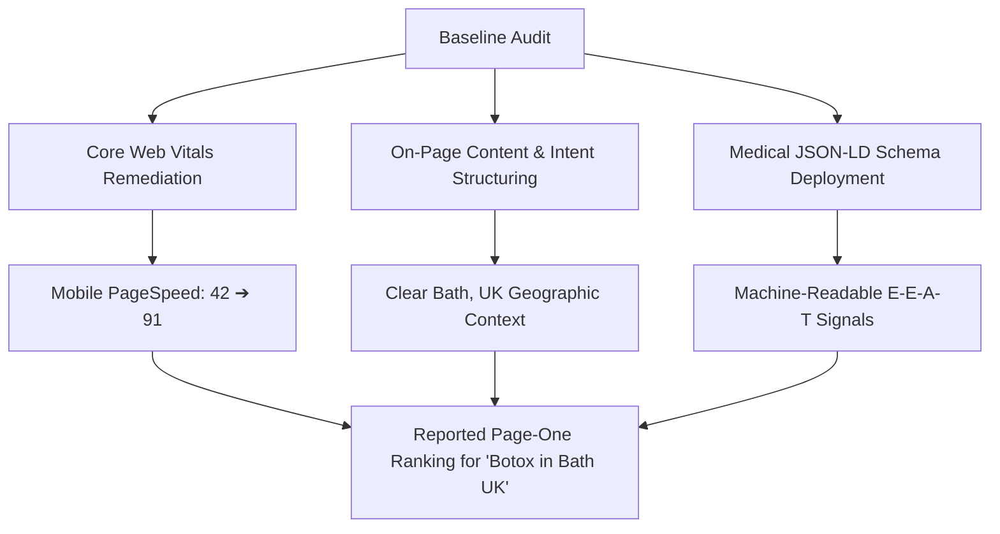

If you own an aesthetic clinic, dental practice, or medical center, you probably built a clean WordPress website expecting local patients to find you. 

Instead, many clinic owners find their site buried on page three or four of Google search, while competing clinics dominate the top spots. The problem is rarely your medical expertise—it is almost always **technical WordPress friction, sluggish mobile load times, and missing clinical schema**.

When prospective patients search for high-value treatments—such as **"Botox in Bath UK"**—their commercial intent is immediate. They are ready to book a consultation with a qualified local provider:

```text
Local Patient Search Intent Flow:
[ Local Patient in Bath, UK ] ──> Searches: "Botox in Bath UK"
                                  ├── High Commercial Value / Ready to Book
                                  ├── Geographic Proximity Constraint
                                  └── Strict Medical Trust Requirement (E-E-A-T)
```

This case study breaks down the exact technical WordPress SEO and on-page optimization performed for **[Moda Wellness](https://modawellness.co.uk/)**, a medical aesthetics practice led by Dr. Naim Toci in Bath, Somerset, and how resolving core technical bottlenecks delivered a **reported page-one ranking** on Google.

> [!NOTE]
> **Case Study Snapshot & Verified Results:**
> * **Client Website:** [modawellness.co.uk](https://modawellness.co.uk/) (Bath, Somerset, UK)
> * **CMS Stack:** WordPress, LiteSpeed Cache, Custom Medical Schema
> * **Demonstrated Search Ranking:** Page One on Google for `"Botox in Bath UK"`
> * **Technical Deliverable:** Mobile PageSpeed score improved from **42 → 91**, eliminating mobile bounce friction.
> * **Key Takeaway for Clinic Owners:** High-intent patient queries require fast mobile load speeds, explicit medical schema, and geographically anchored service architecture.

---

## 1. The Challenge: Disconnected Search Signals on WordPress

When evaluating the clinic's digital footprint, the core issue was not clinical capability. Dr. Toci had established procedural experience and active client treatments. However, search engines could not easily parse the clinic's authority due to three common WordPress pitfalls:

### A. Mobile Performance Bottlenecks (PageSpeed Score: 42/100)
A baseline audit revealed a mobile PageSpeed score of **42/100**. Slow initial server response times, unoptimized treatment images, and render-blocking plugin scripts created sluggish mobile load times (exceeding 4.8 seconds on mobile 4G). Because most local searches for aesthetic and wellness treatments happen on smartphones, this lag directly throttled organic rankings.

### B. Missing Medical Structured Data (Schema.org)
Search engines evaluate healthcare and aesthetic websites under strict **Your Money or Your Life (YMYL)** quality standards. The WordPress site lacked structured JSON-LD data to verify Dr. Toci as a licensed medical practitioner or define Moda Wellness as an established physical clinic in Bath. Google's crawler had to guess clinical credentials from unstructured page text.

### C. Entity and Review Fragmentation
While verified patient consent and clinical reviews were logged through clinical platforms (such as FaceConsent), those trust signals were completely isolated from the website's crawlable code and Google Business Profile.

---

## 2. Technical SEO & On-Page Implementation

Rather than resorting to risky link schemes or plugin bloat, we executed a clean technical overhaul directly in WordPress:



### Step 1: Core Web Vitals & Mobile Optimization
* **Asset Optimization:** Compressed and converted high-resolution treatment imagery into modern WebP formats with proper dimension attributes to eliminate layout shifts (CLS).
* **Script Deferral:** Reorganized WordPress plugin assets and deferred non-essential JavaScript to unblock the main thread.
* **Cache Architecture:** Configured server-level page caching and object caching rules.
* **Outcome:** Mobile PageSpeed improved from **42 to 91**, providing an instantaneous browsing experience for mobile searchers.

### Step 2: On-Page Architecture & Geographic Targeting
* Refactored page titles and heading tags (`H1`, `H2`) to reflect exact clinical treatments paired with geographic modifiers ("Bath, UK").
* Eliminated thin and overlapping service descriptions, replacing them with clear procedural overviews, safety explanations, and consultation expectations.
* Ensured clear NAP (Name, Address, Phone number) consistency matching regional directories.

### Step 3: Medical JSON-LD Schema Implementation
We deployed custom JSON-LD schema directly into the WordPress theme, explicitly defining:
* `@type: "MedicalBusiness"` and `"LocalBusiness"`
* Practitioner details (`@type: "Physician"`), linking professional background and certifications.
* Precise physical address in Bath, Somerset, UK.
* Treatment definitions using `@type: "MedicalProcedure"`.

This structured data gave search engines—and modern AI answer engines—unambiguous entity verification of who was offering the treatment and where.

---

## 3. The Reported Search Outcome & Business Impact

Following the technical cleanup, on-page restructuring, and schema deployment, the client achieved a **reported page-one ranking** for the commercial query:

> **Target Query:** `"Botox in Bath UK"`  
> **Reported Status:** Page One on Google Search  
> **Target Audience:** Prospective aesthetic clients seeking local treatment in Bath, UK

### Why Local Page-One Visibility Drives Clinic Enquiries
In aesthetic medicine, visibility on page one is not about abstract traffic numbers—it is about high-intent conversion:
* **High Conversion Intent:** Patients searching "Botox in Bath UK" have moved past curiosity. They are actively deciding which local clinic to contact for a consultation.
* **Overcoming Patient Hesitation:** In an industry requiring clinical trust, pairing a page-one search presence with fast mobile load times and verified doctor credentials significantly reduces patient booking anxiety.
* **Google Local Map Pack Reinforcement:** When on-page geographic signals align with structured data, the clinic gains stronger authority signals across both organic listings and local map results.

*Note on Ranking Claims: Search engine results vary based on searcher location, search history, device type, and ongoing algorithm updates. A page-one ranking is not a permanent guarantee, but it validates that Google recognized the clinic's local relevance, technical health, and entity trustworthiness over competing pages.*

---

## 4. Key Lessons for WordPress Clinic and Practice Owners

If you operate a medical clinic, dental office, or aesthetic practice, several actionable principles apply:

1. **Local Searchers Prioritize Mobile Speed:** If your mobile site takes more than 3 seconds to render, potential patients will return to search results and choose a competitor.
2. **Help Search Engines Understand Your Credentials:** Modern algorithms require structured schema. Telling Google that an accredited doctor runs your clinic via JSON-LD is far more effective than hoping a crawler reads an "About" paragraph.
3. **Avoid Generic Service Pages:** A page titled simply "Treatments" or "Aesthetics" rarely ranks for local intent. Dedicated, well-structured pages targeting specific procedures in your city provide a clear landing destination.
4. **Connect Clinical Proof to Search:** Reviews, verified registrations, and transparent pricing information reinforce both search ranking factors and patient conversion rates.

---

## Local SEO & Technical Website Optimization for Clinics

Are you running an aesthetic clinic, private practice, or healthcare business with a WordPress site that isn't appearing where local patients search?

I work directly with clinic owners and healthcare entrepreneurs to diagnose crawl errors, fix sluggish mobile load times, and implement structured local SEO that attracts qualified appointments.

* **Get a Dedicated Practice Audit:** Request a [Free Technical Website & Local SEO Audit](/free-audit) to uncover what is holding your clinic back in Google search.
* **Keep Your Clinic Site Fast & Protected:** Review our ongoing [WordPress Maintenance & Retainer Plans](/wordpress-maintenance).
* **Discuss Your Local Visibility:** [Book a direct consultation](/contact) to map out a targeted local search strategy for your practice.
