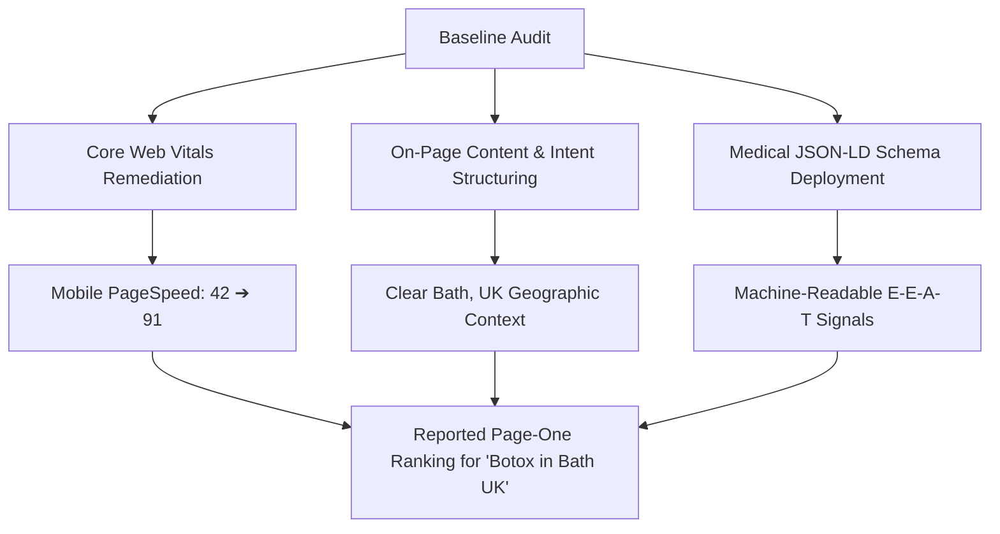

For local aesthetic clinics and medical practitioners, search visibility is rarely about chasing thousands of generic visitors. It is about appearing at the exact moment a prospective patient in your immediate area searches for a qualified provider.

When someone searches for a phrase like **"Botox in Bath UK"**, their search intent is unmistakable. They are not looking for an academic definition of botulinum toxin. They are looking for a trusted, local clinic in or near Bath where they can book an aesthetic consultation.

```text
Local Search Intent Flow:
[ User in Bath, UK ] ──> Searches: "Botox in Bath UK"
                         ├── High Commercial Intent
                         ├── Geographic Proximity Constraint
                         └── Strict Medical Trust Requirement (E-E-A-T)
```

This case study examines the technical SEO and on-page work performed for **Moda Wellness**, an aesthetic wellness practice led by Dr. Naim Toci in Bath, Somerset, and how addressing underlying technical bottlenecks supported a reported **page-one ranking** on Google.

> [!NOTE]
> **Summary & Key Takeaway:**
> Achieving high local visibility for medical and wellness services requires aligning three disciplines:
> 1. **Technical Performance:** Fast, stable mobile rendering so local searchers don't bounce.
> 2. **Clinical Entity Authority (E-E-A-T):** Explicit medical JSON-LD schema that clarifies practitioner qualifications and physical location.
> 3. **Search Intent Alignment:** Structuring on-page headings and service copy around exact regional treatments rather than broad cosmetic buzzwords.

---

## 1. The Challenge: Disconnected Search Signals

When evaluating the clinic's digital footprint, the core issue was not a lack of clinical skill or dedication. Dr. Toci had established procedural experience and active client treatments. However, search engines could not easily parse the clinic's authority due to several structural and technical gaps:

### A. Mobile Performance Bottlenecks
A baseline audit revealed a mobile PageSpeed score of **42/100**. Slow initial server response times, unoptimized image assets, and render-blocking scripts created sluggish mobile load times. Because most local searches for health and aesthetic services happen on mobile devices, this friction directly limited organic discovery.

### B. Missing Structured Data (Schema.org)
Search engines evaluate medical and wellness websites under stringent **Your Money or Your Life (YMYL)** quality guidelines. The website lacked structured JSON-LD data to identify Dr. Toci as a qualified practitioner or define Moda Wellness as an established physical clinic in Bath. Search engine crawlers had to infer details from unstructured page text.

### C. Entity and Review Fragmentation
While procedural consent and verified client interactions were logged through clinical platforms (such as FaceConsent), those trust signals were isolated from the website's crawlable code and Google My Business profile.

---

## 2. Technical SEO & On-Page Implementation

Rather than resorting to low-quality link building or repetitive keyword stuffing, we focused on systematic technical and structural improvements:



### Step 1: Core Web Vitals & Mobile Optimization
* **Asset Optimization:** Compressed and converted high-resolution treatment imagery into modern WebP formats with proper dimension attributes to eliminate layout shifts (CLS).
* **Script Deferral:** Reorganized WordPress plugin assets and deferred non-essential JavaScript to unblock the main thread.
* **Cache Architecture:** Configured page caching and server-level response rules.
* **Outcome:** Mobile PageSpeed improved from **42 to 91**, providing an instantaneous browsing experience for mobile searchers.

### Step 2: On-Page Architecture & Geographic Targeting
* Refactored page titles and heading tags (`H1`, `H2`) to reflect exact clinical treatments paired with geographic modifiers ("Bath, UK").
* Eliminated thin and overlapping service descriptions, replacing them with clear procedural overviews, safety explanations, and consultation expectations.
* Ensured clear NAP (Name, Address, Phone number) consistency matching regional directories.

### Step 3: Medical JSON-LD Schema Implementation
We deployed custom JSON-LD schema directly into the page templates, explicitly defining:
* `@type: "MedicalBusiness"` and `"LocalBusiness"`
* Practitioner details (`@type: "Physician"`), linking professional background and certifications.
* Precise physical address in Bath, Somerset, UK.
* Treatment definitions using `@type: "MedicalProcedure"`.

This structured data gave search engines—and modern AI answer engines—unambiguous entity verification of who was offering the treatment and where.

---

## 3. The Reported Search Outcome

Following the technical cleanup, on-page restructuring, and schema deployment, the client achieved a **reported page-one ranking** for the commercial query:

> **Target Query:** `"Botox in Bath UK"`  
> **Reported Status:** Page One on Google Search  
> **Target Audience:** Prospective aesthetic clients seeking local treatment in Bath, UK

### Context on Ranking Claims
*Search engine results vary based on user location, search history, device type, and ongoing algorithm updates. A page-one ranking is not a permanent guarantee, but it validates that Google recognized the clinic's local relevance, technical health, and entity trustworthiness over competing pages.*

---

## 4. Key Lessons for Local Service and Clinic Owners

If you operate a medical clinic, dental office, or local wellness practice, several actionable principles apply:

1. **Local Searchers Prioritize Mobile Speed:** If your mobile site takes more than 3 seconds to render, potential patients will return to search results and choose a competitor.
2. **Help Search Engines Understand Your Credentials:** Modern algorithms require structured schema. Telling Google that an accredited doctor runs your clinic via JSON-LD is far more effective than hoping a crawler reads an "About" paragraph.
3. **Avoid Generic Service Pages:** A page titled simply "Treatments" or "Aesthetics" rarely ranks for local intent. Dedicated, well-structured pages targeting specific procedures in your city provide a clear landing destination.
4. **Connect Clinical Proof to Search:** Reviews, verified registrations, and transparent pricing information reinforce both search ranking factors and patient conversion rates.

---

## Work With an Experienced Technical SEO Consultant

Whether you run an aesthetic clinic, private practice, or local service business, strong search rankings start with clean code, fast load times, and structured content.

* Explore our [WordPress Maintenance & Retainer Services](/wordpress-maintenance) to keep your site fast, secure, and error-free.
* Request a [Free Technical Website Audit](/free-audit) to uncover what is holding your search visibility back.
* [Contact me directly](/contact) to discuss how technical SEO and search-focused content can support your business growth.
