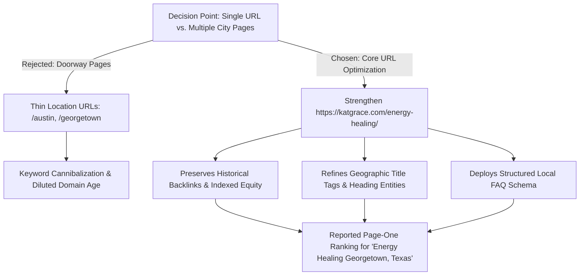

For holistic practitioners, somatic coaches, and wellness healers, building an online presence often feels like a delicate balancing act.

Many practitioners offer remote, virtual sessions to clients worldwide, but also want to welcome in-person clients from their local community. When local clients seek personal care—whether for somatic support, trauma integration, or Reiki—they turn to Google with location-specific queries like **"Energy Healing Georgetown, Texas"**.

```text
Holistic Practice Dilemma:
┌────────────────────────────────────────────────────────┐
│ Global Online Sessions (Zoom / Worldwide)             │
│                       vs.                              │
│ Local In-Person Sessions (Georgetown & Austin, TX)     │
└────────────────────────────────────────────────────────┘
Goal: Rank locally without diluting global authority.
```

This case study examines the strategic SEO and on-page decisions implemented for **[Kat Grace Healing](https://katgrace.com/)**, a trauma-informed practitioner and energy healer based in Central Texas, leading to a reported **page-one ranking** for the target query.

> [!NOTE]
> **Summary & Key Takeaways:**
> * **Client Website:** [katgrace.com](https://katgrace.com/) (Central Texas / Virtual Worldwide)
> * **Optimized Live URL:** [katgrace.com/energy-healing/](https://katgrace.com/energy-healing/)
> * **Target Search Query:** `"Energy Healing Georgetown, Texas"`
> * **Reported Search Outcome:** Page One on Google Search
> * **Core Strategic Deliverable:** Preserving established URL equity over doorway sub-pages, structuring dual session containers ($144 vs $222), and deploying custom `FAQPage` + `LocalBusiness` schema.
> * **Strategic Takeaway:** You do not need dozens of duplicate city pages to rank locally. Consolidating authority into an established service URL while embedding geographic context and structured FAQ data produces sustainable rankings.

---

## 1. The Challenge: Balancing Regional Demand and URL Authority

During initial keyword research using Google Ads and Search Console data, we analyzed two adjacent geographic markets:
1. **Austin, Texas Metro Area:** Higher total search volume (10–100 monthly searches per modality), but dominated by high-density directories, large holistic clinics, and established local centers.
2. **Georgetown, Texas:** A growing community north of Austin with lower total volume, but exceptionally high commercial intent and a significantly less saturated organic SERP.

### The Doorway Page Trap
A frequent recommendation by generic SEO agencies is to generate thin, boilerplate pages for every nearby municipality:
* `/energy-healing-austin/`
* `/energy-healing-georgetown/`
* `/energy-healing-round-rock/`
* `/energy-healing-cedar-park/`

For an independent solo practitioner, this doorway approach creates critical vulnerabilities:
* **Equity Dilution:** Inbound links, social mentions, and user traffic get split across 5–10 weak pages instead of building a powerhouse URL.
* **Algorithm Penalties:** Google's helpful content systems aggressively de-value thin doorway pages that swap city names with identical service text.
* **Client Confusion:** Prospective clients arriving on a city-specific page struggle to understand the practitioner's primary background, modalities, or online booking policy.

---

## 2. The Decision-Making Process: Why We Strengthened the Existing URL

We evaluated whether to create a new dedicated landing page (`/energy-healing-georgetown/`) versus upgrading the live service page (`/energy-healing/`).

The strategic decision was clear: **retain and elevate the existing URL.**



### Why Consolidating Beat Fragmenting:
1. **Historical Indexed Equity:** `https://katgrace.com/energy-healing/` already had Google Search Console impressions and clean index status. Starting a new URL would forfeit existing crawl history.
2. **Dual Audience Serving:** By weaving Georgetown and Austin geographic references naturally into the primary service page, local searchers found immediate physical context, while global virtual visitors were not alienated by an hyper-local template.
3. **Cohesive Practitioner Voice:** Preserving a single authoritative page allowed Kat's authentic practitioner voice to shine without sounding like a robotic directory.

---

## 3. On-Page Implementation: Intent, Pricing & Schema

### Step 1: Aligning Title Tag and Search Intent
We re-anchored the page title and meta description to explicitly connect the primary modality with the physical service area:

* **Title Tag:**  
  `Energy Healing in Georgetown & Austin, TX | Kat Grace — Reiki & Chakra Restoration`
* **Meta Description:**  
  `Restore your peace with Energy Healing in Georgetown, TX (or online worldwide). Blending Reiki, Quantum-Touch, and chakra alignment. 50 Min · $144.`

This structure signaled to Google that the practitioner serves Georgetown and the greater Austin area, while also clarifying pricing and duration upfront.

### Step 2: Clear Service Packaging & Modality Differentiation
Local searchers frequently feel uncertain about what "energy healing" entails. To reduce friction and improve engagement metrics, we structured the page with clear, distinct offerings:
* **Energy Healing Session (50 Min | $144):** Dedicated to focused, silent energy work blending Reiki and Quantum-Touch.
* **Private Integration Session (75 Min | $222):** An interactive container combining somatic coaching, intuitive guidance, and energy integration.

This clarity helped visitors immediately identify the right service container for their needs.

### Step 3: Structured FAQPage and LocalBusiness Schema
To provide unambiguous signals to Google and AI answer engines, we integrated JSON-LD schema into the page:

1. **LocalBusiness & Person Schema:** Linked Kat Grace as an individual practitioner to her modalities and designated service areas in Georgetown and Austin, Texas.
2. **FAQPage Schema:** Addressed common procedural questions directly in code:
   * *"Do you offer in-person energy healing in Georgetown, Texas?"*
   * *"What is the difference between Energy Healing and an Integration Session?"*
   * *"What modalities are used during an Energy Healing session?"*

By answering these queries in structured code, search crawlers could extract direct answers, improving search result snippet clarity and AI engine citation readiness.

---

## 4. The Reported Search Result

Following the on-page restructuring and schema integration, the practitioner achieved a **reported page-one ranking** for:

> **Target Query:** `"Energy Healing Georgetown, Texas"`  
> **Reported Status:** Page One on Google Search  
> **Search Context:** Local commercial and informational search intent in Central Texas

### Ranking Context & Reality Check
*Organic rankings can vary based on searcher proximity, browsing personalization, and evolving search algorithms. This result demonstrates that deliberate on-page alignment and structured data allow boutique practices to compete effectively for high-intent geographic terms.*

---

## 5. Key Takeaways for Coaches, Healers & Service Businesses

1. **Protect Your Existing URLs:** If your website already has indexed pages with historical equity, optimize them before creating new sub-pages.
2. **Clarify Local vs. Remote Availability:** Explicitly stating where in-person sessions occur and where virtual sessions are available prevents client confusion and satisfies local search algorithms.
3. **Use FAQ Schema for Commercial Intent:** Directly addressing session duration, pricing, and locations in your FAQ and schema markup gives search engines the structured facts they need.
4. **Authentic Voice Wins:** You do not need to sound like a generic corporate directory. Combining your authentic practitioner voice with structured technical SEO yields the best conversion outcomes.

---

## Local SEO & Strategic Website Growth for Practitioners & Coaches

Are you a therapist, holistic coach, healer, or consultant looking to attract more local clients without sacrificing your authentic message?

I help independent practitioners cut through SEO noise, streamline their service pages, and implement structured local visibility that attracts ideal clients.

* **Get a Dedicated Practitioner Review:** Request a [Free Website & Local SEO Review](/free-audit) to identify what is keeping your practice from ranking in your local area.
* **Non-Technical Writing System:** Read our [Blog Writing Guide for Non-Technical Clients](/blog/blog-guide-case-study) to see how we help business owners publish content without losing their voice.
* **Plan Your Local Strategy:** [Schedule a direct consultation](/contact) to map out a clear, authentic search visibility plan for your practice.
