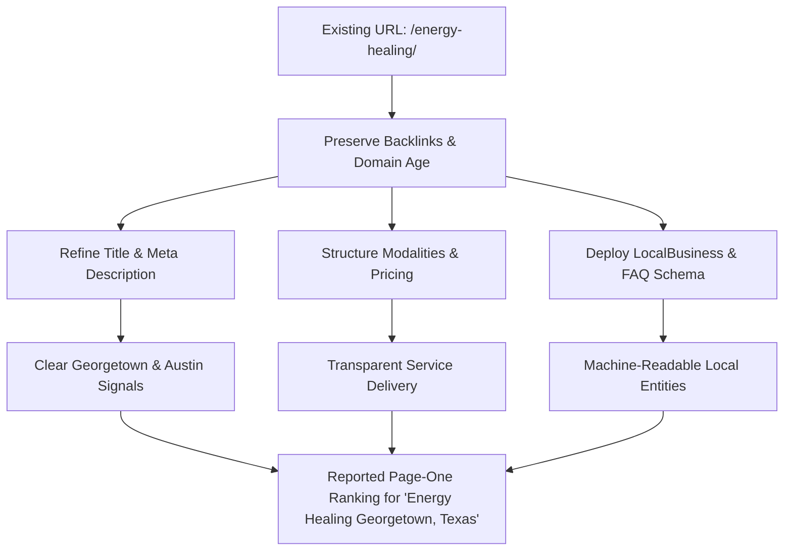

For holistic practitioners, somatic coaches, and wellness healers, building an online presence often feels like a balancing act. 

Many practitioners offer remote, virtual sessions to clients worldwide, but also want to welcome in-person clients from their local community. When local clients seek personal care—whether for acupuncture, Reiki, or somatic support—they turn to Google with location-specific queries like **"Energy Healing Georgetown, Texas"**.

```text
Holistic Practice Dilemma:
┌────────────────────────────────────────────────────────┐
│ Global Online Sessions (Zoom / Worldwide)             │
│                       vs.                              │
│ Local In-Person Sessions (Georgetown & Austin, TX)     │
└────────────────────────────────────────────────────────┘
Goal: Rank locally without diluting global authority.
```

This case study examines the strategic SEO and on-page decisions implemented for **Kat Grace Healing** (`katgrace.com`), a trauma-informed practitioner and energy healer based in Central Texas, leading to a reported **page-one ranking** for the target query.

> [!NOTE]
> **Summary & Key Takeaway:**
> You do not need dozens of duplicate doorway pages to rank in your local market. 
> Preserving the authority of an established service URL, refining metadata to match regional intent, and implementing structured FAQ schema can outperform fragmented local landing pages.

---

## 1. The Challenge: Balancing Regional Demand and URL Authority

During initial keyword research using Google Ads and Search Console data, we analyzed two adjacent geographic markets:
1. **Austin, Texas Metro Area:** Higher total search volume, but dominated by high-density directories, multi-practitioner clinics, and high competition.
2. **Georgetown, Texas:** A growing community north of Austin with lower total query volume, but exceptionally high commercial intent and less saturated local organic competition.

### The Doorway Page Trap
A common, flawed recommendation in local SEO is to generate thin, boilerplate pages for every nearby municipality:
* `/energy-healing-austin/`
* `/energy-healing-georgetown/`
* `/energy-healing-round-rock/`

For an independent practitioner, this approach introduces severe drawbacks:
* It dilutes domain authority across multiple low-content URLs.
* It risks search penalties for duplicate content and doorway pages.
* It creates a confusing user experience for prospective clients who just want to understand what a session involves.

---

## 2. The Strategy: Strengthen Established Core URLs

Instead of fracturing domain equity, our strategy was simple: **retain and elevate existing high-equity URLs.**

The website already maintained an indexed service page at `https://katgrace.com/energy-healing/`. Rather than starting from scratch with a new slug, we optimized this established page to capture both geographic relevance and modality depth.



### Step 1: Aligning Title Tag and Search Intent
We re-anchored the page title and meta description to explicitly connect the primary modality with the physical service area:

* **Title Tag:**  
  `Energy Healing in Georgetown & Austin, TX | Kat Grace — Reiki & Chakra Restoration`
* **Meta Description:**  
  `Restore your peace with Energy Healing in Georgetown, TX (or online worldwide). Blending Reiki, Quantum-Touch, and chakra alignment. 50 Min · $144.`

This structure clearly signaled to Google that the practitioner serves Georgetown and the greater Austin area, while also clarifying pricing and duration upfront.

### Step 2: Clear Service Packaging & Modality Differentiation
Local searchers frequently feel uncertain about what "energy healing" entails. To reduce friction and improve engagement metrics, we structured the page with clear, distinct offerings:
* **Energy Healing Session (50 Min | $144):** Dedicated to focused, silent energy work blending Reiki and Quantum-Touch.
* **Private Integration Session (75 Min | $222):** An interactive container combining somatic coaching, intuitive guidance, and energy integration.

This clarity helped visitors immediately identify the right service container for their needs.

### Step 3: Structured FAQPage and LocalBusiness Schema
To provide unambiguous signals to Google and AI answer engines, we integrated JSON-LD schema into the page:

1. **LocalBusiness & Person Schema:** Linked Kat Grace as an individual practitioner to her modalities and designated service areas in Georgetown and Austin, Texas.
2. **FAQPage Schema:** Addressed common procedural questions directly in code:
   * *"Do you offer in-person energy healing in Georgetown, Texas?"*
   * *"What is the difference between Energy Healing and an Integration Session?"*
   * *"What modalities are used during an Energy Healing session?"*

By answering these queries in structured code, search crawlers could extract direct answers, improving search result snippet clarity and AI engine citation readiness.

---

## 3. The Reported Search Result

Following the on-page restructuring and schema integration, the practitioner achieved a **reported page-one ranking** for:

> **Target Query:** `"Energy Healing Georgetown, Texas"`  
> **Reported Status:** Page One on Google Search  
> **Search Context:** Local commercial and informational search intent in Central Texas

### Ranking Context
*Organic rankings can vary based on searcher proximity, browsing personalization, and evolving search algorithms. This result demonstrates that deliberate on-page alignment and structured data allow boutique practices to compete effectively for high-intent geographic terms.*

---

## 4. Key Takeaways for Service Businesses & Coaches

1. **Protect Your Existing URLs:** If your website already has indexed pages with historical equity, optimize them before creating new sub-pages.
2. **Clarify Local vs. Remote Availability:** Explicitly stating where in-person sessions occur and where virtual sessions are available prevents client confusion and satisfies local search algorithms.
3. **Use FAQ Schema for Commercial Intent:** Directly addressing session duration, pricing, and locations in your FAQ and schema markup gives search engines the structured facts they need.
4. **Authentic Voice Wins:** You do not need to sound like a generic corporate directory. Combining your authentic practitioner voice with structured technical SEO yields the best conversion outcomes.

---

## Build a Defensible Search Presence for Your Practice

If you run a wellness clinic, coaching practice, or professional service business, search visibility does not require complex marketing jargon—it requires clean technical execution and search intent alignment.

* Read our [Blog Writing Guide for Non-Technical Clients](/blog/blog-guide-case-study) to see how we help business owners publish content without losing their voice.
* Get a [Free Website & SEO Audit](/free-audit) to evaluate your current search performance.
* [Contact me today](/contact) to discuss how we can improve your website's local discoverability.
