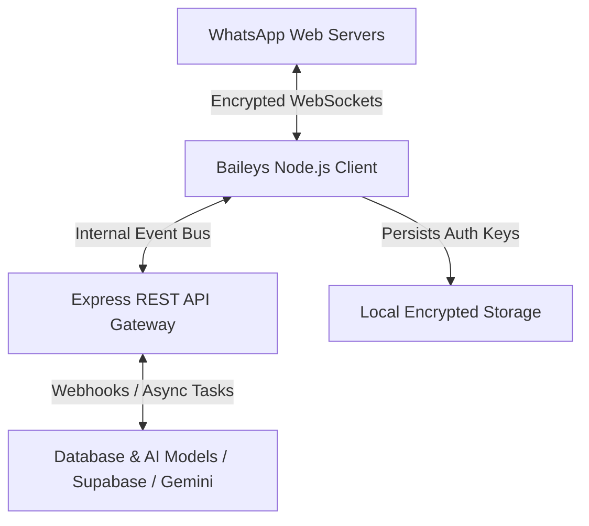

When businesses decide to automate customer communication on WhatsApp, they generally face a strategic decision between two distinct paths:

1. **Meta's Official WhatsApp Cloud API:** Managed, formal, and conversation-metered.
2. **Custom Web Socket Integration via Baileys:** Lightweight, self-hosted, and flexible for internal workflows.

For startups, internal tooling, and specialized workflow automation—such as automated invoice dispatching, homework evaluation with AI, or order status notifications—**Baileys** has emerged as one of the most capable open-source libraries in the Node.js ecosystem.

My technical content on this subject has consistently gained organic search traction, with my portfolio website **reportedly ranking #1 on page one for the target query "WhatsApp Baileys Integration 2026"**.

```text
Google Search Result (Observed):
Query: "WhatsApp Baileys Integration 2026"
Position: #1 on Page One
Destination: naveengaur.com (Technical Architecture Guides)
```

This guide explains the architecture of a production-grade Baileys integration, covers session management and WebSocket error handling, and candidly outlines the operational risks and tradeoffs you must consider before deploying.

> [!NOTE]
> **Summary & Key Architecture Checklist:**
> Running Baileys reliably in production requires treating it as a distributed network service, not a quick desktop script:
> * Use `useMultiFileAuthState` to persist encryption keys safely.
> * Implement exponential backoff on `515 (restart required)` disconnect codes.
> * Avoid memory leaks by streaming media buffers directly rather than holding raw audio/video in Node memory.
> * Run on a dedicated Linux VPS with a process supervisor (such as PM2).

---

## 1. Why Baileys? Architecture & Resource Efficiency

Unlike legacy browser-based automation tools (such as Puppeteer or Selenium) that launch a full Chromium instance to automate WhatsApp Web, Baileys reverse-engineers the underlying WebSocket protocol:



### Key Architectural Advantages:
* **Minimal Memory Footprint:** Where a headless browser consumes 500MB to 1.5GB of RAM per session, a Baileys process typically runs comfortably within 100MB–200MB of RAM.
* **Low Latency:** Direct binary protocol communication ensures inbound messages trigger application handlers within milliseconds.
* **Multi-Device Support:** Baileys acts as a standard companion device linked via QR code or pairing code, allowing the primary phone to remain online independently.

---

## 2. Core Implementation: Session Persistence & Connection Loops

The most frequent point of failure in rookie Baileys implementations is improper session handling and disconnect management.

### Step 1: Secure Credential Storage with `useMultiFileAuthState`
Baileys requires saving cryptographic keys across restarts so you do not have to re-scan the QR code every time the server boots:

```typescript
import makeWASocket, { 
  useMultiFileAuthState, 
  DisconnectReason 
} from "@whiskeysockets/baileys";
import { Boom } from "@hapi/boom";

async function startWhatsAppClient() {
  const { state, saveCreds } = await useMultiFileAuthState("auth_session");

  const sock = makeWASocket({
    auth: state,
    printQRInTerminal: true,
    browser: ["Ubuntu", "Chrome", "20.0.04"],
  });

  // Automatically save credential updates
  sock.ev.on("creds.update", saveCreds);

  // Connection Lifecycle Handler
  sock.ev.on("connection.update", (update) => {
    const { connection, lastDisconnect } = update;

    if (connection === "close") {
      const statusCode = (lastDisconnect?.error as Boom)?.output?.statusCode;
      const shouldReconnect = statusCode !== DisconnectReason.loggedOut;

      console.log(`Connection closed due to: ${statusCode}. Reconnecting: ${shouldReconnect}`);

      if (shouldReconnect) {
        // Implement backoff rather than immediate aggressive restart
        setTimeout(() => startWhatsAppClient(), 5000);
      } else {
        console.error("Session terminated by server (Logged Out). Clean auth directory.");
      }
    } else if (connection === "open") {
      console.log("WhatsApp client connected successfully.");
    }
  });

  return sock;
}
```

---

## 3. Production Hardening: Debugging Real-World Failures

Over multiple production deployments, several subtle edge cases emerge:

### A. The `515 Restart Required` Status Code
During multi-device sync, WhatsApp's servers periodically instruct client sockets to restart to finalize cryptographic key rotations. If your code does not catch status code `515` and trigger an immediate clean restart, the socket enters a dead state where it appears open but fails to deliver messages.

### B. Memory Leaks During Media Downloads
When handling high volumes of images, voice notes, or PDF invoices, reading raw buffers directly into process memory (`downloadMediaMessage`) will rapidly exhaust heap memory on small servers. 
* **Fix:** Stream incoming binary data to temporary disk storage or directly to an S3/Supabase bucket, freeing the Node.js garbage collector.

### C. LID vs. JID Address Mapping
WhatsApp multi-device infrastructure assigns both standard phone JIDs (`[country_code][number]@s.whatsapp.net`) and Linked Identity (LID) addresses (`[number]@lid`) to user accounts. Ensure your database normalizes incoming message senders to the primary phone JID to avoid fragmented contact threads.

---

## 4. Operational Limitations and Risk Management

Anyone considering an unofficial WhatsApp integration must understand the platform constraints:

| Consideration | Baileys Web Integration | Official WhatsApp Cloud API |
| :--- | :--- | :--- |
| **Setup Cost** | Zero platform fee (Open Source) | Free tier (1,000 service conv/mo) + Meta rates |
| **Hardware Requirement** | Self-hosted Linux VPS (1–2GB RAM) | Cloud-hosted by Meta |
| **Message Approval** | None required | Outbound templates require Meta approval |
| **Account Ban Risk** | Present if used for spam or high unsolicited volume | None (Governed by Meta terms) |
| **Best Used For** | Internal alerts, 1-on-1 CRM sync, transactional notifications | High-volume marketing broadcasts, enterprise scale |

> [!CAUTION]
> **Anti-Spam Compliance:** Never use Baileys for unsolicited cold messaging or bulk marketing broadcasts. Automated spam detection on WhatsApp is aggressive and will result in permanent number bans. Keep integration strictly opt-in and transactional.

---

## 5. Deployment Recommendation: Linux VPS + PM2

To ensure uninterrupted uptime, deploy your Baileys service on a reliable Linux server (such as Ubuntu on an Oracle Cloud or DigitalOcean instance) supervised by **PM2**:

```bash
# Install process manager globally
npm install -g pm2

# Launch service with auto-restart on memory limit
pm2 start dist/server.js --name "whatsapp-bot" --max-memory-restart 500M

# Enable startup persistence across server reboots
pm2 startup
pm2 save
```

This ensures that if the process encounters an unhandled rejection or socket freeze, PM2 restarts the instance immediately.

---

## Build Custom WhatsApp Automation with an Experienced Architect

Integrating WhatsApp into your business operations should streamline your workflows, not introduce infrastructure headaches.

* Explore our dedicated [Custom WhatsApp Automation Services](/whatsapp-automation) for CRM integrations, AI bots, and backend dispatching.
* Read our comparison of [Baileys vs. WhatsApp Cloud API: Which Should You Choose?](/blog/baileys-vs-whatsapp-cloud-api).
* Review our guide on [Deploying Baileys Bots on Oracle Cloud VPS](/blog/oracle-vps-baileys-whatsapp-bot-deployment).
* [Book a technical consultation](/contact) to discuss building a custom, reliable WhatsApp integration for your business.
