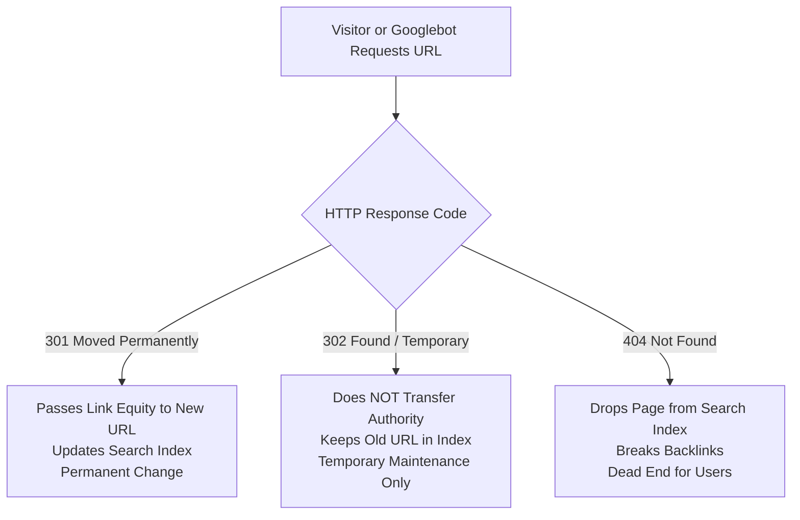
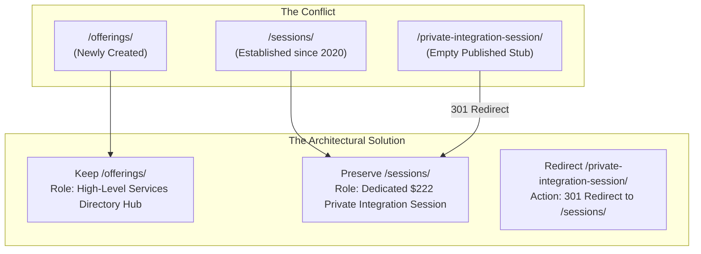

Changing page URLs on a live WordPress website is one of the highest-risk operations in web development.

Whether you are rebranding, consolidating duplicate content, or restructuring your service hierarchy, altering permalinks without an ironclad redirect strategy will quickly destroy years of search engine equity.

Consider what happens when a URL changes:
1. External backlinks pointing to your old URL instantly break into **404 Not Found** errors.
2. Search engines drop the old page from the index, treating it as dead.
3. Visitors clicking old social links, bookmarks, or email newsletters hit dead-end error pages.

Yet, websites evolve. As businesses grow, initial URL structures—often populated with theme demo slugs or uncoordinated page titles—must be cleaned up.

In this guide, we break down how to plan, map, and execute **WordPress 301 permanent redirects** with zero loss of SEO authority. We also review a real-world production case study from our cleanup of `katgrace.com`, where we deployed **22 permanent redirects** to disentangle conflicting service pages.

---

## 1. What Is a 301 Redirect (and When Should You Use It)?

HTTP status codes tell browsers and search crawlers how to handle a requested page. When restructuring URLs, three main status codes come into play:



### The Difference:
* **301 Moved Permanently:** Informs search engines that the content has moved for good. Google transfers 90% to 99% of the original page's PageRank to the destination URL. **Always use 301 for permanent URL restructures.**
* **302 Found (Temporary):** Signals that the move is temporary. Search engines retain the old URL in the index and do not transfer ranking signals.
* **404 Not Found:** Signals that the page no longer exists. If an old page has valuable backlinks or organic traffic, a 404 permanently destroys that value.

---

## 2. The Danger of "Redirect Chains" and the "Soft 404" Trap

Before implementing a single redirect, you must understand two widespread mistakes that sabotage website migrations:

### Mistake A: Redirect Chains and Loops
A redirect chain occurs when an incoming request is passed through multiple intermediate hops before arriving at its final destination:

```txt
URL A  ──(301)──>  URL B  ──(301)──>  URL C  ──(301)──>  URL D (Final Destination)
```

Every hop in a chain:
- Adds **200ms to 500ms** of server latency.
- Increases the risk that mobile browsers time out.
- Wastes crawl budget. Googlebot frequently aborts crawling if a chain exceeds 3 to 5 hops.

> [!WARNING]
> **Always redirect directly to the final canonical URL.** If URL A previously pointed to URL B, and URL B now moves to URL C, update URL A so it points directly to URL C.

### Mistake B: The "Soft 404" (Redirecting Everything to the Homepage)
When cleaning up 50 old pages, lazy developers often create a wildcard rule redirecting all dead URLs directly to `/`.

Google explicitly treats this as a **Soft 404**. When Google sees that a specific URL (like `/holistic-trauma-recovery/`) redirects to a broad homepage, it recognizes that search intent is not satisfied and refuses to pass ranking equity. 

**Rule of Thumb:** Every 301 redirect must point to the most relevant equivalent page. If no relevant page exists, a clean `404 Not Found` or `410 Gone` is better than an irrelevant redirect.

---

## 3. How to Build a URL Redirect Mapping Sheet

The foundation of any successful URL migration is a **1-to-1 Redirect Mapping Sheet**. 

Before altering WordPress, document every URL in a spreadsheet with five mandatory columns:

| Legacy Source URL | Search Intent / Content | Action | Canonical Destination URL | Verified HTTP Status |
| :--- | :--- | :--- | :--- | :--- |
| `/private-integration-session/` | Individual integration session booking | 301 Redirect | `https://katgrace.com/sessions/` | `HTTP/2 301` |
| `/about-2/` | Duplicate theme demo clone | 301 Redirect | `https://katgrace.com/about-me/` | `HTTP/2 301` |
| `/services-2/` | Duplicate theme demo clone | 301 Redirect | `https://katgrace.com/offerings/` | `HTTP/2 301` |
| `/testimonials/` | Legacy testimonial archive | 301 Redirect | `https://katgrace.com/testimonials-3/` | `HTTP/2 301` |
| `/shop/` | Inactive WooCommerce demo stub | Draft (404) | N/A (Intent does not exist) | `HTTP/2 404` |

---

## 4. Case Study: Resolving Service Page Conflicts on Kat Grace

During our technical SEO overhaul of `katgrace.com`, we encountered a classic architectural dilemma: **service page fragmentation**.

The website had three URLs competing for client attention and search indexation:
1. `/offerings/` (Page ID 37274) – A newly created services directory.
2. `/sessions/` (Page ID 605) – Kat's established service page, created in 2020.
3. `/private-integration-session/` (Page ID 37242) – An empty published stub created during recent edits.

### The Problem:
If we kept all three, Google would suffer from keyword cannibalization. If we deleted `/sessions/` to adopt `/private-integration-session/`, we would wipe out four years of historical search equity tied to Page ID 605.



### The Implementation:
1. **Preserve `/sessions/` as the Target:** We retained `https://katgrace.com/sessions/` for Kat's core 1-on-1 offering ($222 / 75-minute Private Integration Session).
2. **Designate `/offerings/` as the Hub:** We structured `/offerings/` as the overview pillar that introduces all healing modalities and links down to `/sessions/`.
3. **Deploy a 301 Redirect for the Stub:** We switched `/private-integration-session/` to Draft and configured a permanent 301 redirect in Rank Math pointing to `/sessions/`.

---

## 5. Implementing 301 Redirects in WordPress via Rank Math

While server-level redirects (.htaccess or Nginx) are slightly faster, managing redirects through **Rank Math Pro** provides centralized auditing, 404 monitoring, and automatic cache synchronization.

### The Configuration Pattern:
In Rank Math's redirections engine, each rule was configured with strict parameters:
* **Source URL:** `^private-integration-session/?$` (Exact match pattern to catch with or without trailing slash)
* **Destination URL:** `https://katgrace.com/sessions/`
* **Redirection Type:** `301 Moved Permanently`
* **Status:** `Active`

```sql
-- Direct database verification in wp_rank_math_redirections
SELECT id, sources, url_to, header, status 
FROM wp_rank_math_redirections 
WHERE url_to LIKE '%/sessions/%';
```

---

## 6. How to Verify 301 Redirects via Production HTTP Headers

Never rely on a web browser to test redirects. Browsers cache 301 redirects aggressively, creating false positives where an old redirect appears to work even after the server configuration is broken.

Always verify redirect headers directly from the terminal using `curl`:

```bash
# Test the redirect response headers directly against the live server
curl -I -s https://katgrace.com/private-integration-session/
```

### The Output You Want to See:
```http
HTTP/2 301 
location: https://katgrace.com/sessions/
x-redirect-by: Rank Math
x-litespeed-cache: miss
content-type: text/html; charset=UTF-8
```

### What This Confirms:
1. **`HTTP/2 301`:** Confirms the redirect is permanent and transfers search equity.
2. **`location: https://katgrace.com/sessions/`:** Confirms the destination is exact, with no intermediate hops or redirect chains.
3. **`x-redirect-by: Rank Math`:** Proves the application layer processed the rule correctly.

We repeated this automated verification across all **22 newly created redirect rules**:

```text
✓ /about-2/                     -> 301 -> https://katgrace.com/about-me/
✓ /services-2/                  -> 301 -> https://katgrace.com/offerings/
✓ /testimonials/                -> 301 -> https://katgrace.com/testimonials-3/
✓ /home-2/                      -> 301 -> https://katgrace.com/
✓ /private-integration-session/ -> 301 -> https://katgrace.com/sessions/
```

---

## 7. When Should You Hire a WordPress Developer for URL Restructuring?

While setting up a single redirect for a renamed blog post is straightforward, restructuring a live business website requires architectural precision.

You should hire an experienced WordPress technical developer if:
- **You are planning a site redesign or rebranding:** To prevent the catastrophic 30% to 50% organic traffic drop that often follows unmanaged URL changes.
- **You have inherited an old site with hundreds of duplicate pages:** To systematically audit internal links, blog post references, and form integrations before unpublishing pages.
- **You need white-label technical support for your agency:** To ensure client migrations launch smoothly with zero 404 spikes in Google Search Console.

---

<div style={{
  background: 'linear-gradient(135deg, rgba(196, 163, 90, 0.08) 0%, rgba(13, 13, 13, 0.08) 100%)',
  border: '1px solid rgba(196, 163, 90, 0.2)',
  borderRadius: '12px',
  padding: '28px 32px',
  margin: '2.5em 0',
  boxShadow: '0 10px 30px -10px rgba(196, 163, 90, 0.15)',
  display: 'flex',
  flexDirection: 'column',
  gap: '16px',
}}>
  <h3 style={{ margin: 0, color: '#C4A35A', fontSize: '1.4rem' }}>
    Planning a WordPress Site Restructure or Migration?
  </h3>
  <p style={{ margin: 0, fontSize: '1rem', lineHeight: '1.6', color: '#E0E0E0' }}>
    Do not risk your search traffic with unmanaged URL changes. I provide comprehensive URL mapping, zero-chain 301 implementations, and server-verified migrations for high-traffic WordPress websites and digital agencies.
  </p>
  <div style={{ marginTop: '8px' }}>
    <a 
      href="/#contact" 
      style={{
        display: 'inline-block',
        backgroundColor: '#C4A35A',
        color: '#0D0D0D',
        padding: '12px 24px',
        borderRadius: '6px',
        fontWeight: '600',
        textDecoration: 'none',
        fontSize: '0.95rem'
      }}
    >
      Schedule a URL Architecture Review
    </a>
  </div>
</div>

