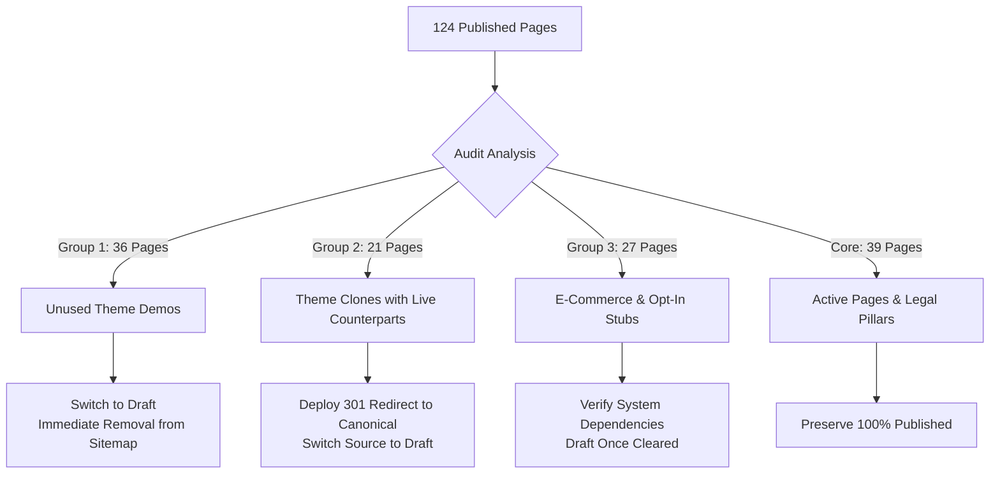
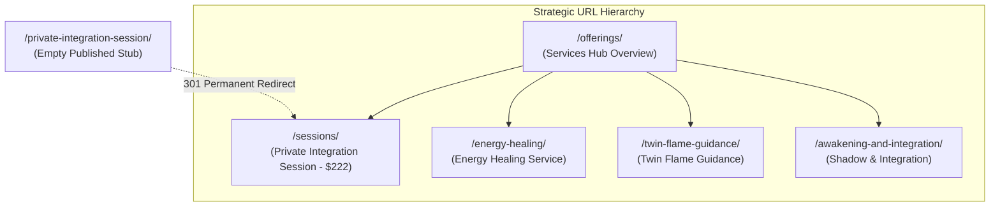

If you manage an established WordPress site or run a digital marketing agency, you have likely encountered this scenario:

A client website looks visually polished on the front-end, but behind the scenes, the search footprint is a complete disaster. 

Years of theme imports, developer handoffs, and quick page revisions have left a trail of technical debt:
- **Numeric clone URLs** (`/about-2/`, `/services-3/`, `/contact-2/`) competing against genuine pages.
- **Dozens of orphan theme templates** (`/style-guide/`, `/case-study-template/`, `/podcast-detail/`) indexed in Google.
- **Empty e-commerce stubs** (`/shop/`, `/cart/`, `/checkout/`) on sites that do not sell physical products.
- **Zombie XML sitemaps** exposing ancient custom post types that were abandoned four years ago.

When organic traffic stagnates or drops after a redesign, site owners often blame algorithm updates. But in reality, search engines are choking on **crawl bloat and duplicate page equity**.

In this case study, we document the complete, step-by-step technical SEO cleanup executed for **Kat Grace**, an established spiritual integration and trauma-recovery practitioner (`katgrace.com`). 

Using production SSH access and WP-CLI, we **pruned 85 bloated URLs (a 68.5% reduction in public pages)**, deployed **22 permanent 301 redirects**, eliminated a **zombie portfolio sitemap**, and restructured conflicting service pages—**with zero broken links and zero downtime**.

Here is the exact engineering framework you can use to audit, plan, and execute a production WordPress cleanup.

---

## The Core Challenge: Invisible Technical Debt

When Kat's website was brought in for a comprehensive technical SEO overhaul, a baseline audit revealed a massive discrepancy between what Kat actually offered and what WordPress was presenting to search engines:


### The Diagnostic Findings:
1. **124 Published Pages for a Boutique Practice:** The site only had roughly 20 legitimate pages. Over **80 pages** were orphaned starter templates imported years earlier with a Blossom theme.
2. **Conflicting Service Architecture:** Kat had three overlapping URLs competing for the same intent: `/offerings/`, `/sessions/`, and an empty newly published stub `/private-integration-session/`.
3. **Crawl Waste in Sitemaps:** Rank Math's master sitemap index was actively serving `blossom-portfolio-sitemap.xml`, feeding Google 27 demo portfolio entries from 2020.
4. **Duplicate Permalinks:** Clones like `/testimonials/` and `/testimonials-2/` were competing directly with the live `/testimonials-3/`.

Our objective was clear: **Sanitize the site's search footprint, preserve every ounce of earned link equity, and align WordPress with Kat's actual service offerings without breaking live client workflows.**

---

## Phase 1: The Read-Only Audit & Inventory

The golden rule of senior WordPress engineering: **Never modify a live website during the audit phase.** 

Before touching a single setting, we extracted an exhaustive inventory via SSH and WP-CLI to map every published page, post, taxonomy term, and redirect rule into a structured JSON dataset:

```bash
# Extract full inventory of published pages via WP-CLI
wp post list \
  --post_type=page \
  --post_status=publish \
  --fields=ID,post_title,post_name,post_date,post_modified,post_parent \
  --format=json > katgrace_published_pages.json

# Extract all active 301 redirects in Rank Math
wp db query "SELECT id, sources, url_to, header FROM wp_rank_math_redirections;" > rank_math_redirects.tsv
```

This produced a complete baseline inventory:
- **124 published pages**
- **85 published blog posts**
- **2 existing Rank Math redirect rules**
- **4 child sitemaps** in `sitemap_index.xml` (Pages, Posts, Categories, and Portfolio)

---

## Phase 2: The 3-Group Action Matrix

To clean up 85 non-essential pages safely, you cannot simply bulk-delete records. You must categorize every single URL based on its search equity, user intent, and system dependencies:



### Group 1: Clearly Unused Theme Demos (36 Pages)
* **Examples:** `/style-guide/`, `/course-detail/`, `/recipe/`, `/podcast-detail/`, `/case-study-template/`, `/instagram-landing/`.
* **Diagnosis:** These were starter templates created during theme activation. They had zero inbound links, zero organic search impressions, and no business utility.
* **Action:** Set `post_status = 'draft'`. Moving to draft immediately removes them from public view and XML sitemaps without permanently destroying the template data in MySQL.

### Group 2: Duplicate Clones with Live Equivalents (21 Pages)
* **Examples:** `/about-2/`, `/about-3/`, `/contact-2/`, `/services-2/`, `/services-listing/`, `/testimonials/`, `/home-2/`.
* **Diagnosis:** Over years of edits, pages were duplicated rather than updated. Outside sites or old social posts might still point to these URLs.
* **Action:** 
  1. Map each clone to Kat's live canonical URL.
  2. Deploy permanent `301 Moved Permanently` rules in Rank Math.
  3. Switch source pages to Draft.

### Group 3: Functional Stubs & Lead Funnels (27 Pages)
* **Category A (12 WooCommerce Stubs):** `/shop/`, `/cart/`, `/checkout/`, `/my-account/` (and numeric duplicates). Confirmed WooCommerce was inactive; switched to Draft.
* **Category B (15 Opt-In Templates):** 2020 theme templates like `/ebook-landing/` and `/newsletter-landing/`. Investigated **FluentCRM** automations to ensure no active email autoresponders linked to them before drafting.

---

## Phase 3: Resolving Service Architecture (`/offerings/` vs. `/sessions/`)

One of the most critical decisions in any technical SEO cleanup is resolving overlapping service pages. 

Kat had three conflicting URLs:
1. `https://katgrace.com/offerings/` (Page ID 37274, newly created)
2. `https://katgrace.com/sessions/` (Page ID 605, established page from 2020)
3. `https://katgrace.com/private-integration-session/` (Page ID 37242, empty published stub)



### The Architectural Decision:
* **Keep `/offerings/` as the Hub:** Serves as the high-level services directory, introducing Kat's healing modalities and linking out to individual offerings.
* **Preserve `/sessions/` for Private Integration Sessions:** Page ID 605 had accumulated historical authority since 2020. Rather than changing its permalink and risking search volatility, we preserved `/sessions/` as the dedicated page for the Private Integration Session ($222 / 75 min).
* **301-Redirect `/private-integration-session/`:** The empty newly published stub was switched to Draft and permanently 301-redirected to `/sessions/`.

---

## Phase 4: Purging Zombie Sitemaps & Invalidating Cache

After drafting 85 pages and configuring 22 new redirect rules, the changes must be reflected in the XML sitemap. 

Rank Math stores generated sitemaps in transients and memory. If you only update the database, stale sitemaps will continue serving decommissioned URLs to Googlebot.

### Step 1: Deactivate Legacy Custom Post-Type Sitemaps
The Blossom theme had registered a custom post type called `blossom-portfolio` in 2020. Even though the theme was no longer actively used for portfolios, Rank Math was still exposing `blossom-portfolio-sitemap.xml` containing 27 dummy projects.

We disabled the post type directly in Rank Math's options:
```bash
wp option patch update rank-math-options-sitemap pt_blossom-portfolio_sitemap off
```

### Step 2: Flush Transients & Invalidate Rank Math Storage
```bash
# Delete all WordPress transients
wp transient delete --all

# Invalidate Rank Math sitemap storage via PHP runtime
wp eval "\RankMath\Sitemap\Cache::invalidate_storage();"

# Purge server-level LiteSpeed page cache
wp litespeed-purge all
```

---

## Phase 5: Production Verification with Live HTTP Headers

An audit is only complete when verified against the live production server. We wrote an automated Python verification script using `curl` to test exact HTTP header responses:

```text
--- 301 PERMANENT REDIRECTS (RANK MATH VERIFIED) ---
URL: https://katgrace.com/private-integration-session/
HTTP/2 301 
location: https://katgrace.com/sessions/
x-redirect-by: Rank Math

URL: https://katgrace.com/about-2/
HTTP/2 301 
location: https://katgrace.com/about-me/
x-redirect-by: Rank Math

URL: https://katgrace.com/services-2/
HTTP/2 301 
location: https://katgrace.com/offerings/
x-redirect-by: Rank Math

--- DRAFTED DEMO PAGES (CLEAN 404 WITHOUT INDEXING LEAKS) ---
URL: https://katgrace.com/shop/             -> HTTP/2 404 Not Found
URL: https://katgrace.com/cart/             -> HTTP/2 404 Not Found
URL: https://katgrace.com/ebook-landing/    -> HTTP/2 404 Not Found
URL: https://katgrace.com/freebies/         -> HTTP/2 404 Not Found

--- CORE ACTIVE SERVICE PAGES (FAST 200 OK) ---
URL: https://katgrace.com/offerings/        -> HTTP/2 200 OK
URL: https://katgrace.com/sessions/         -> HTTP/2 200 OK
URL: https://katgrace.com/about-me/         -> HTTP/2 200 OK
```

---

## The Results: Before vs. After

| Metric | Before Audit | After Optimization | Business & SEO Impact |
| :--- | :--- | :--- | :--- |
| **Total Published Pages** | **124** | **39** | **68.5% reduction** in crawl bloat |
| **Total Draft Pages** | 7 | **92** | 85 demo templates safely preserved |
| **Child Sitemaps in Master Index** | 4 | **3** | `blossom-portfolio-sitemap` eliminated |
| **URLs in `page-sitemap.xml`** | **123** | **38** | **-85 low-quality URLs** removed from Google |
| **Active 301 Redirect Rules** | 2 | **24** | 22 legacy clones mapped to canonical targets |
| **Internal Broken Links** | Unknown | **0** | Verified across all 85 posts and menus |
| **Active Lead Funnels** | At Risk | **100% Retained** | `/free-resources/` & opt-in forms intact |

---

## What to Look for When Hiring a WordPress Technical SEO Developer

If your agency is preparing for a client website migration or redesign, or if your business has accumulated years of duplicate pages, be careful who you hire.

Many freelancers will install a generic redirect plugin, bulk-delete pages in `wp-admin`, and accidentally trigger hundreds of 404 errors across your existing backlinks.

When vetting a developer for technical SEO implementation, look for:
1. **Pre-flight Dependency Verification:** They query your database to confirm that no blog posts, navigation menus, or email marketing funnels link to pages before they are decommissioned.
2. **Database-Level Precision:** They use WP-CLI and direct server commands to inspect serialized options and transients, rather than relying solely on admin dashboard clicks.
3. **Information Architecture Experience:** They know how to distinguish high-level service hubs from dedicated transactional pages without cannibalizing established permalinks.
4. **Header-Level Testing:** They verify redirections and sitemaps using terminal `curl` requests to ensure caching layers (LiteSpeed, Cloudflare, Nginx) serve the correct status codes to Googlebot.

---

<div style={{
  background: 'linear-gradient(135deg, rgba(196, 163, 90, 0.08) 0%, rgba(13, 13, 13, 0.08) 100%)',
  border: '1px solid rgba(196, 163, 90, 0.2)',
  borderRadius: '12px',
  padding: '28px 32px',
  margin: '2.5em 0',
  boxShadow: '0 10px 30px -10px rgba(196, 163, 90, 0.15)',
  display: 'flex',
  flexDirection: 'column',
  gap: '16px',
}}>
  <h3 style={{ margin: 0, color: '#C4A35A', fontSize: '1.4rem' }}>
    Need a Senior WordPress Developer to Handle Your Site Migration or Cleanup?
  </h3>
  <p style={{ margin: 0, fontSize: '1rem', lineHeight: '1.6', color: '#E0E0E0' }}>
    Whether you are an established business cleaning up years of URL bloat or a digital agency looking for a reliable technical partner for white-label site migrations, I provide zero-downtime, production-verified technical SEO implementations.
  </p>
  <div style={{ marginTop: '8px' }}>
    <a 
      href="/#contact" 
      style={{
        display: 'inline-block',
        backgroundColor: '#C4A35A',
        color: '#0D0D0D',
        padding: '12px 24px',
        borderRadius: '6px',
        fontWeight: '600',
        textDecoration: 'none',
        fontSize: '0.95rem'
      }}
    >
      Book an Architectural Audit
    </a>
  </div>
</div>

