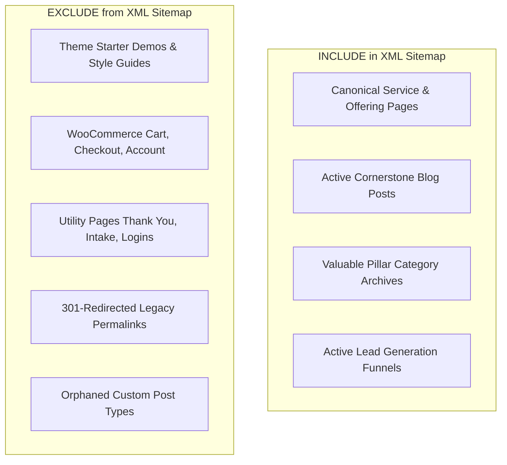
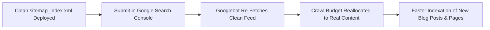

When was the last time you opened your website's XML sitemap?

For most business owners and marketing agencies, the XML sitemap is treated as an automatic "set-and-forget" feature. You install Rank Math or Yoast, turn on the XML sitemap module, submit `sitemap_index.xml` to Google Search Console, and assume everything is working.

In reality, XML sitemaps on established WordPress websites are frequently infested with **ghost URLs**:
- **Dormant custom post types** registered by themes you uninstalled two years ago.
- **Dozens of starter demo templates** (`/style-guide/`, `/case-study-template/`, `/pricing-2/`) quietly submitted to Google.
- **Empty e-commerce endpoints** (`/cart/`, `/checkout/`, `/shop-3/`) on service websites with no active store.
- **Orphaned landing pages** from expired 2020 marketing campaigns.

This invisible clutter creates **sitemap bloat**. Search engines waste precious crawl budget indexing low-quality, duplicate pages rather than focusing on the service pages and blog posts that generate revenue.

In this guide, we break down how to audit, clean, and optimize a bloated WordPress XML sitemap using **Rank Math**. We also share the real data from our cleanup of `katgrace.com`, where we eliminated a zombie portfolio sitemap and **slashed `page-sitemap.xml` from 123 URLs down to 38 clean, revenue-focused pages**.

---

## 1. What Should (and Should Not) Be in an XML Sitemap?

An XML sitemap is not a directory of every URL that exists in your database. It is a curated roadmap telling Google: *"These are the high-value, canonical pages I want you to index and rank."*



### The Indexable Quality Rule:
If a page does not deserve to rank on Google's first page for a meaningful search query, **it does not belong in your XML sitemap**.

---

## 2. Published vs. Draft vs. Noindex vs. 404: Choosing the Right Status

When cleaning up unwanted URLs, developers often get confused about which mechanism to use. Here is the architectural decision matrix:

| Status | Public Visitor Experience | Googlebot Indexation | Included in Sitemap? | Best Used For |
| :--- | :--- | :--- | :--- | :--- |
| **Published** | Accessible (200 OK) | Indexed | **Yes** | Core services, active posts, homepage |
| **Draft** | Hidden (404 Not Found) | De-indexed | **No** | Obsolete theme demos, dormant starter pages |
| **Noindex** | Accessible (200 OK) | Blocked from search | **No** | Client intake forms, thank-you pages, account hubs |
| **301 Redirect** | Redirected to target | Passes equity to target | **No** | Renamed pages, duplicate URLs with live equivalents |
| **404 / 410** | Error page | Dropped from index | **No** | Dead pages with zero backlinks or relevance |

---

## 3. Case Study: Eliminating 69% of Sitemap Bloat on Kat Grace

During our technical SEO audit of `katgrace.com`, inspecting the live master sitemap index (`https://katgrace.com/sitemap_index.xml`) revealed severe architectural bloat:

```xml
<!-- BEFORE: katgrace.com Master Sitemap Index -->
<sitemapindex xmlns="http://www.sitemaps.org/schemas/sitemap/0.9">
    <sitemap><loc>https://katgrace.com/post-sitemap.xml</loc></sitemap>
    <sitemap><loc>https://katgrace.com/page-sitemap.xml</loc></sitemap> <!-- 123 URLs! -->
    <sitemap><loc>https://katgrace.com/category-sitemap.xml</loc></sitemap>
    <sitemap><loc>https://katgrace.com/blossom-portfolio-sitemap.xml</loc></sitemap> <!-- ZOMBIE FEED -->
</sitemapindex>
```

### The Two Major Issues:
1. **The Zombie Portfolio Sitemap:** A Blossom theme imported in 2020 had registered a custom post type called `blossom-portfolio`. Rank Math was generating a dedicated `blossom-portfolio-sitemap.xml` containing 27 demo portfolio projects that Kat had never touched in four years.
2. **123 Page URLs for a Boutique Practice:** Kat's actual business only had roughly 20 core pages. The page sitemap was flooded with WooCommerce shop stubs, numeric duplicate pages (`/services-2/`, `/about-3/`), and abandoned theme opt-ins.

```mermaid
flowchart LR
    subgraph Before [Before: 123 Pages + Zombie Feed]
        A1[page-sitemap.xml: 123 URLs]
        A2[blossom-portfolio-sitemap.xml: 27 Demos]
        A3[post-sitemap.xml: 85 Posts]
    end

    subgraph Optimization [Optimization Workflow]
        B1[Disable blossom-portfolio Post Type]
        B2[Draft 85 Demo & Duplicate Stubs]
        B3[Flush Transients & Invalidate RM Cache]
    end

    subgraph After [After: Clean & Curated]
        C1[page-sitemap.xml: 38 URLs]
        C2[Zombie Portfolio Feed PURGED]
        C3[post-sitemap.xml: 85 Posts]
    end

    Before --> Optimization --> After
```



---

## 4. How to Clean Up a Rank Math XML Sitemap via WP-CLI

Rather than clicking through dozens of dashboard screens, production sitemap optimization can be executed cleanly via terminal commands.

### Step 1: Deactivate the Zombie Post-Type Sitemap
To eliminate `blossom-portfolio-sitemap.xml`, we updated Rank Math's options directly in MySQL:

```bash
# Deactivate portfolio post-type inclusion in Rank Math sitemap
wp option patch update rank-math-options-sitemap pt_blossom-portfolio_sitemap off
```

### Step 2: Switch Bloated Pages to Draft
We shifted 85 demo and duplicate pages to Draft status. Because Rank Math filters sitemaps by `post_status = 'publish'`, drafted pages are automatically excluded from the XML feed:

```bash
# Example: Batch drafting obsolete demo IDs
wp post update 1727 1728 1729 1730 33429 33430 33431 33432 --post_status=draft
```

### Step 3: Invalidate the Rank Math Sitemap Cache
Rank Math stores generated sitemap XML strings in database transients (`_transient_rank_math_sitemap_*`). If you do not invalidate this storage, visitors and Googlebot will continue to receive stale XML:

```bash
# 1. Delete all WordPress transients
wp transient delete --all

# 2. Invalidate Rank Math sitemap storage via PHP runtime
wp eval "\RankMath\Sitemap\Cache::invalidate_storage();"

# 3. Purge LiteSpeed page cache
wp litespeed-purge all
```

---

## 5. Verifying the New Sitemap via Command Line

After clearing transients, we verified the live sitemap directly from the server:

```bash
# Test the master sitemap index output
curl -s https://katgrace.com/sitemap_index.xml
```

### Verified Clean Production Output:
```xml
<?xml version="1.0" encoding="UTF-8"?>
<sitemapindex xmlns="http://www.sitemaps.org/schemas/sitemap/0.9">
	<sitemap><loc>https://katgrace.com/post-sitemap.xml</loc></sitemap>
	<sitemap><loc>https://katgrace.com/page-sitemap.xml</loc></sitemap>
	<sitemap><loc>https://katgrace.com/category-sitemap.xml</loc></sitemap>
	<sitemap><loc>https://katgrace.com/video-sitemap.xml</loc></sitemap>
</sitemapindex>
```

`blossom-portfolio-sitemap.xml` was completely purged from the index.

We then parsed `page-sitemap.xml` with Python to count the URLs and verify that zero demo stubs remained:

```text
Total URLs in page-sitemap.xml: 38 (Reduced from 123)
WooCommerce demo stubs found: 0
Theme starter templates found: 0
Active lead assets retained: 100% (/free-resources/, /the-daughter-who-sees-clearly/)
```

---

## 6. How to Submit Updated Sitemaps in Google Search Console

Once your sitemap is cleaned, inform Google immediately:

1. **Log in to Google Search Console.**
2. Navigate to **Indexing > Sitemaps** in the left sidebar.
3. Under **Add a new sitemap**, enter `sitemap_index.xml` and click **Submit**.
4. Check the **Discovered pages** count. It will update over the next 48 to 72 hours as Google drops the decommissioned URLs from its crawl queue.



---

## 7. Common Sitemap Mistakes to Avoid

1. **Deleting Pages Without 301 Redirects:** If a page previously earned backlinks, do not draft or delete it without setting up a 301 redirect in Rank Math first.
2. **Leaving Caching Enabled for XML Feeds:** Ensure caching plugins (WP Rocket, LiteSpeed, Cloudflare) exclude `.xml` and `.xsl` feeds from page caching. Serving stale XML sitemaps delays search engine updates.
3. **Submitting Child Sitemaps Individually:** Do not submit `page-sitemap.xml` and `post-sitemap.xml` separately in Search Console. Always submit the master index (`sitemap_index.xml`), which allows Google to discover all child feeds dynamically.

---

<div style={{
  background: 'linear-gradient(135deg, rgba(196, 163, 90, 0.08) 0%, rgba(13, 13, 13, 0.08) 100%)',
  border: '1px solid rgba(196, 163, 90, 0.2)',
  borderRadius: '12px',
  padding: '28px 32px',
  margin: '2.5em 0',
  boxShadow: '0 10px 30px -10px rgba(196, 163, 90, 0.15)',
  display: 'flex',
  flexDirection: 'column',
  gap: '16px',
}}>
  <h3 style={{ margin: 0, color: '#C4A35A', fontSize: '1.4rem' }}>
    Is Your WordPress Sitemap Bloated with Ghost Pages?
  </h3>
  <p style={{ margin: 0, fontSize: '1rem', lineHeight: '1.6', color: '#E0E0E0' }}>
    Sitemap bloat dilutes crawl budget and hurts your rankings. I provide complete technical SEO audits and sitemap sanitization for WordPress websites and digital marketing agencies.
  </p>
  <div style={{ marginTop: '8px' }}>
    <a 
      href="/#contact" 
      style={{
        display: 'inline-block',
        backgroundColor: '#C4A35A',
        color: '#0D0D0D',
        padding: '12px 24px',
        borderRadius: '6px',
        fontWeight: '600',
        textDecoration: 'none',
        fontSize: '0.95rem'
      }}
    >
      Request a Technical SEO Audit
    </a>
  </div>
</div>

